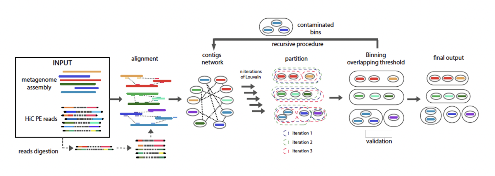

# MetaTOR

[](https://anaconda.org/bioconda/metator)

[](https://github.com/koszullab/metator/actions)
[](https://codecov.io/gh/koszullab/metator)
[](https://opensource.org/licenses/bo-3.0)
[](https://github.com/ambv/black)
<!-- [](https://metator.readthedocs.io) -->

Metagenomic Tridimensional Organisation-based Reassembly - A set of scripts that streamlines the processing and binning of metagenomic metaHiC datasets.

<p align="center">
  
</p>

1. [Installation](#installation)
   1. [With conda](#with-conda)
   2. [With pip](#with-pip)
   3. [Development version](#development-version)
2. [Usage](#usage)
3. [Output files](#output-files)
4. [Contributions](#contributions)
5. [References](#references)
6. [Contact](#contact)
   1. [Authors](#authors)
   2. [Research lab](#research-lab)

## Installation

### With conda

`conda` is the recommended way to install the latest `metator` release:

```sh
conda create -n metator bioconda::metator
```

### With pip

**Note:** although `metator` itself is available from Pypi, several additional libraries are 
not available from Pypi and must be installed separately. Please consider the following 
before installing `metator`:

* Python `3.9` to `3.11` is required.
* The following dependencies should also be locally installed and available in the `$PATH`:
    * [`bowtie2`](http://bowtie-bio.sourceforge.net/bowtie2/index.shtml) or `bwa`
    * [`samtools`](https://www.htslib.org/download/)
    * [`hmmer`](http://hmmer.org/documentation.html)
    * [`prodigal`](https://github.com/hyattpd/Prodigal)
    * [`java`](https://www.oracle.com/java/technologies/downloads/)

* The following non-pythonic librairies are **embedded** when installing `metator` with `pip`: [`louvain 0.3`](https://sourceforge.net/projects/louvain/files/GenericLouvain/) and [`leiden 1.3.0`](https://github.com/CWTSLeiden/networkanalysis).

**Warning:** note that if you install `metator` with `pip`, this may upgrade/downgrade 
versions of the above dependencies and may cause conflicts with other softwares.

```sh
# Install bowtie2, samtools, hmmer, prodigal and java-jdk:
sudo apt update && sudo apt install bowtie2 samtools hmmer prodigal default-jdk

# Install metator from Pypi
pip3 install metator
```

### Development version 

You can use `metator` development version as follows: 

```sh
git clone https://github.com/koszullab/metator
cd metator
pip3 install -e .[dev]
```

## Usage

```sh
metator {network|partition|validation|pipeline|qc|contactmap|pairs|mge} [parameters]
```

A metator command takes the form `metator action --param1 arg1 --param2
arg2 #etc.`

There are three actions/steps in the metator pipeline, which must be run in the
following order:

* `network` : Generate metaHiC contigs network from fastq reads or bam files and normalize it.
* `partition` : Perform the Louvain or Leiden community detection algorithm many times to bin contigs according to the metaHiC signal between contigs.
* `validation` : Use miComplete to validate the bins, then do a recursive decontamination step to remove contamination.

There are a number of other, optional, miscellaneous actions:

* `pipeline` : Run all three of the above actions sequentially or only some of them depending on the arguments given. This can take a while.
* `contactmap` : Generates a contact map from one bin from the final ouptut of metator.
* `qc` : Generates some quality check on the input/output of metator.
* `version` : display current version number.
* `help` : display help message.

A tutorial is available [here](docs/example/metator_tutorial.md) to explain how to use metator. More advanced tutorials to analyze the output files are also available:

* [Anvio](https://merenlab.org/software/anvio/) manual curation of the contaminated bins. Available [here](docs/example/manual_curation_of_metator_MAGs.md).
* Visualization of the MAGs with the contactmap modules of MetaTOR. Available [here](docs/example/MAG_visualization_and_scaffolding.md).

Principle of MetaTOR pipeline:



## Output files

The output files will be in the ouput directory given as parmater or in working directory if no paramater were given. Depending on the command used, different files will be in the ouptut:

| Files/Commands | description | network | partition | validation | pipeline |
| - | :-: | :-: | :-: | :-: | :-: |
| alignment_N_for.bam |Bam file of the forward alignment |X|||X|
| alignment_N_rev.bam |Bam file of the reverse alignment|X|||X|
| alignment_N.pairs.pgz |Pairs of the merge alignment|X|||X|
| network.txt |Normalized network of the metaHiC library|X|||X|
| contig_data_network.txt |Information on contigs after network step|X||||
| clustering_matrix_partition.txt |Matrix of clustering from the partition iterations||X|||
| contig_data_partition.txt |Information on contigs after partition step||X|||
| overlapping_micomplete_results.txt |miComplete results summary file from the partition step|||X|X|
| recursive_micomplete_stepN.txt |miComplete results summary file from the recursive step N|||X|X|
| clustering_matrix_validation.txt |Matrix of clustering from the recursive iterations|||X||
| clustering_matrix.txt |Matrix of clustering from the partition and recursive iterations||||X|
| contig_data_final.txt |Information on contigs after whole pipeline|||X|X|
| **bin_summary.txt** |**Information on the final bins**|||**X**|**X**|
| binning.txt |File with contigs names and their final clustering|||X|X|
| overlapping_bin |Directory with the fasta of the partition bins||X|X|X|
| recursive_bin |Directory with the fasta of the recursive bins|||X|X|
| **final_bin** |**Directory with the fasta of the final bins**|||**X**|**X**|

**Bam alignment files**
For the bam alignments files, only the aligned reads are kept and the bam are sorted by name. The N value correspond to the id (order of the given fastq started at 0)

**Pairs aligment files**
This format is used to store the relevant information of mapping of the merged alignment. It's a s The N value correspond to the id (order of the given fastq started at 0). It is a tab-separated format holding informations about Hi-C pairs. It has an [official specification](https://github.com/4dn-dcic/pairix/blob/master/pairs_format_specification.md) defined by the 4D Nucleome data coordination and integration center. Here we kept 7 columns readID-chr1-pos1-chr2-pos2-strand1-strand2.

**Network file**
This is a tsv file of the network with edgelist form: Id of the first contig, id of the second contig and the weigth of edge normalized.

**Contig data files**
These are the files with all the informations from the contigs:
|ID|Name|Size|GC_content|Hit|Shotgun_coverage|Restriction_site|Core_bin_ID|Core_bin_contigs|Core_bin_size|Overlapping_bin_ID|Overlapping_bin_contigs|Overlapping_bin_size|Recursive_bin_ID|Recursive_bin_contigs|Recursive_bin_size|Final_bin|
|:-:|:-:|:-:|:-:|:-:|:-:|:-:|:-:|:-:|:-:|:-:|:-:|:-:|:-:|:-:|:-:|:-:|
|1|NODE_1|642311|38.6876450815882|3837|41.1565|2006|1|65|2175226|1|396|6322353|1|52|2158803|MetaTOR_1_1|
|2|NODE_2|576356|30.235826468363303|1724|24.509|1256|2|40|1735419|2|401|735419|0|-|-|MetaTOR_2_0|
|3|NODE_3|540571|42.305266098255366|2188|14.5855|3405|3|127|6409484|3|431|13615480|1|112|6385126|MetaTOR_3_1|

They have to have the header when they are use as input but the order of the columns nd if they are others columns doesn't matter when they are used as input files.
Depending on which step of the pipeline have been launch they just have some of these columns:

* `contig_data_network.txt`: columns: ID, Name, Size, GC content, Hit, Shotgun_coverage and Restriction Site only.
* `contig_data_partition.txt`: The same as the previous with the information of core bins and overlapping bins.
* `contig_data_final.txt`: All the columns.

The shotgun coverage will be filled only if the depth.txt file is given, otherwise it will be filled with `-`. This column is only necessarry for the *abundance* and the *theoritical_hit* normalization. The restriction will also be filled with `-` if no enzyme are given. This column is only necessary for the *RS* and the *theoritical_hit* normalization.
Moreover, if the contig is not binned (no HiC reads mapped on it) all the columns with binning information will be filled with `-`, and if a bin is not recursively decontamined because it's smaller than the size threshold or it doesn't have any contamination the recusive bin information will be filled `0`, `-`, `-`. Finally, if the bin is not in a final bin, it will be annotated `ND` in the last column (for not determined).

**clustering matrix files**
The clustering matrix files are at the `.npz` format which is a compresed foramt for sparsed matrix. This sparsed matrix contains the ratio of time each pairs of contigs are clusterize together by the algorithm of clustering (either Louvain or Leiden). The partition matrix contains the information for the partition step, the recursive one for the recursive step and the general one is the mean of both matrices. Be careful the index of the contigs are **zero-based** and not one-based as in the contig data file.

It's possible to read them in python using the `scipy.sparse.load_npz()` function. If the users wants a tsv file instead, he or she could load the matrix in python using load_npz and make sure to transform the matrix in the `scipy.sparse.coo_matrix` function and used the function from metator `metator.io.save_sparse_matrix` to save it as tsv file.

**binning.txt file**
This is a tsv file with two columns: the contig name and the final were the contig is. It only contains contigs which are binned. It could be use a an input to import a binning results in anvio.

**Bin summary file**
This is the summary of the data of the final bins build with all the step of metator (GC content, number of contigs, N50, HiC abundancy ...). It also contains the data from the final miComplete evaluation (Present Markers, Completeness, Redundancy, Weighted completeness	and Weighted redundancy).

||Length|GC-content|Present_Markers|Completeness|Redundancy|Weighted_completeness|Weighted_redundancy|Contigs|N50|L50|N90|L90|CDs|recursive|step|parent|HiC_abundance|
|:-:|:-:|:-:|:-:|:-:|:-:|:-:|:-:|:-:|:-:|:-:|:-:|:-:|:-:|:-:|:-:|:-:|
|metator_00031_00000|6169839.00|57.47|103.00|0.98|1.01|0.98|1.02|153.00|287729.00|8.00|40103.00|27.00|5707.00|False|0||3.3423|
|metator_00001_00000|4695682.00|42.58|103.00|0.98|1.03|0.99|1.08|326.00|71792.00|22.00|13441.00|85.00|4141.00|False|0||1.9909|
|metator_00030_00001|5094713.00|45.69|105.00|1.00|1.10|1.00|1.13|44.00|428652.00|5.00|99776.00|15.00|4726.00|False|1|metator_00030_00000|0.3708|

## Contributions 

We welcome contributions to the project. Please refer to the [CONTRIBUTING.md](CONTRIBUTING.md) file for more information.

## References

* [Metagenomic chromosome conformation capture (meta3C) unveils the diversity of chromosome organization in microorganisms](https://www.ncbi.nlm.nih.gov/pmc/articles/PMC4381813/), Martial Marbouty, Axel Cournac, Jean-François Flot, Hervé Marie-Nelly, Julien Mozziconacci, and Romain Koszul, eLife, 2014
* [Meta3C analysis of a mouse gut microbiome](https://www.biorxiv.org/content/early/2015/12/17/034793), Martial Marbouty, Lyam Baudry, Axel Cournac, Romain Koszul, 2015
* [Scaffolding bacterial genomes and probing host-virus interactions in gut microbiome by proximity ligation (chromosome capture) assay](https://www.ncbi.nlm.nih.gov/pmc/articles/PMC5315449/), Martial Marbouty, Lyam Baudry, Axel Cournac, and Romain Koszul, Science Advances, 2017

## Contact

### Authors

* amaury.bignaud@pasteur.fr
* jacques.serizay@pasteur.fr
* lyam.baudry@pasteur.fr
* thfoutel@pasteur.fr
* martial.marbouty@pasteur.fr
* romain.koszul@pasteur.fr

### Research lab

[Spatial Regulation of Genomes](https://research.pasteur.fr/en/team/spatial-regulation-of-genomes/) (Institut Pasteur, Paris)
