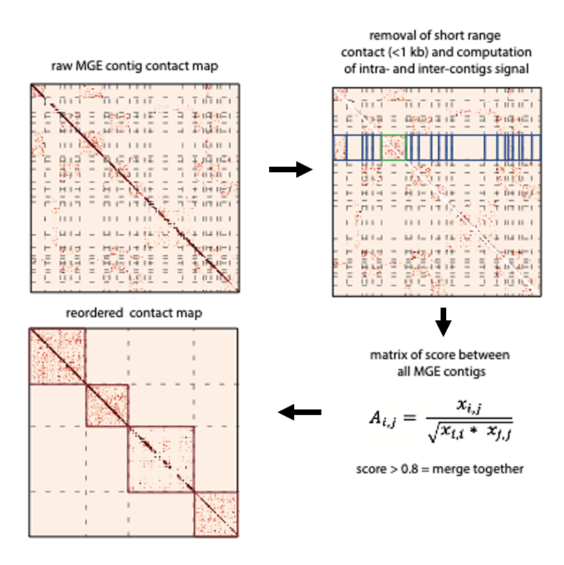

# MetaTOR

[](https://anaconda.org/bioconda/metator)

[](https://github.com/koszullab/metator/actions)
[](https://codecov.io/gh/koszullab/metator)
[](https://opensource.org/licenses/bo-3.0)
[](https://github.com/astral-sh/ruff)
<!-- [](https://metator.readthedocs.io) -->

Metagenomic Tridimensional Organisation-based Reassembly - A set of scripts that streamlines the processing and binning of metagenomic metaHiC datasets.

<p align="center">
  
</p>

1. [Installation](#installation)
   1. [With conda](#with-conda)
   2. [With pip](#with-pip)
   3. [Development version](#development-version)
2. [Usage](#usage)
   1. [Principle of MetaTOR pipeline](#Principle-of-MetaTOR-pipeline)
   2. [Output files](#output-files)
   3. [Contact map](#contact-map)
   4. [metator mge](#metator-mge)
      1. [Principle of mge clustering](#Principle-of-mge-clustering)
      2. [Usage](#usage-of-mge)
      3. [Output](#output)
3. [Tutorials](#Tutorials)
4. [Contributions](#contributions)
5. [References](#references)
6. [Contact](#contact)
   1. [Authors](#authors)
   2. [Research lab](#research-lab)

## Installation

### With conda

`conda` is the recommended way to install the latest `metator` release:

```sh
conda create -n metator bioconda::metator
```

### With pip

**Note:** although `metator` itself is available from Pypi, several additional libraries are 
not available from Pypi and must be installed separately. Please consider the following 
before installing `metator`:

* Python `3.10` to `3.14` is required.
* The following dependencies of miComplete, which checks the clusters, should also be locally
  installed and available in the `$PATH`:
    * [`hmmer`](http://hmmer.org/documentation.html)
    * [`prodigal`](https://github.com/hyattpd/Prodigal)
* metaTOR starts from a `.metacool` contact map of the contigs, which
  [hicstuff](https://github.com/koszullab/hicstuff) makes from the reads (`hicstuff pipeline -M metacool`),
  or [metacooler](https://pypi.org/project/metacooler/) from pairs files (`metacooler create pairs`).

**Warning:** note that if you install `metator` with `pip`, this may upgrade/downgrade 
versions of the above dependencies and may cause conflicts with other softwares.

```sh
# Install hmmer and prodigal:
sudo apt update && sudo apt install hmmer prodigal

# Install metator from Pypi
pip3 install metator
```

### Development version 

The development version is managed with [uv](https://docs.astral.sh/uv/). With the
non-Python dependencies listed above installed:

```sh
git clone https://github.com/koszullab/metaTOR
cd metaTOR
uv sync
uv run metator --help
```

See [CONTRIBUTING.md](CONTRIBUTING.md) to run the tests and checks.

## Usage

```sh
metator {network|partition|validation|pipeline|mge} [parameters]
```

A metator command takes the form `metator action --param1 arg1 --param2
arg2 #etc.` `metator --help` lists the actions, `metator action --help`
shows the parameters of an action and `metator --version` the version
number.

There are three actions/steps in the metator pipeline, which must be run in the
following order:

* `network` : Generate the metaHiC network of the contigs from a `.metacool` contact map and normalize it.
* `partition` : Perform the Louvain or Leiden community detection algorithm
  many times to cluster contigs according to the metaHiC signal between
  contigs.
* `validation` : Use miComplete to validate the clusters, then do a recursive
  decontamination step to remove contamination.

The three steps take the `.metacool` contact map of the contigs as their first argument: `network`
reads it, and `partition` and `validation` update it as `pipeline` does (see
[Step by step on a contact map](#step-by-step-on-a-contact-map)). hicstuff makes the map from the
reads (`hicstuff pipeline -M metacool`), and metacooler from pairs files (`metacooler create pairs`,
then `metacooler merge` for several libraries): metaTOR 2.0 reads no reads, alignments or pairs
files, `mge` included, which reads the map.

There are a number of other, optional, miscellaneous actions:

* `pipeline` : Run all three of the above actions sequentially or only some of them depending on the arguments given. This can take a while.
* `mge` : Perform the clustering over mge contigs. A specific section is
  dedicated to this tool below.

metaTOR 2.0 removed the commands that did what hicstuff, metacooler,
instaGRAAL or pairix do: `qc`, `contactmap`, `metacool`, `scaffold` and
`pairs`, and the plots. [Other tools](docs/other-tools.md) says what replaces
each one.


### Principle of MetaTOR pipeline


### Output files

The output files will be in the ouput directory given as parmater or in working directory if no paramater were given. Depending on the command used, different files will be in the ouptut. The tables of a validation (marked *tmp*) are written in the temporary directory of the run (`-T`, in a directory of its own, which the log names), which `-N` keeps: the map holds what they hold, and `metator dump` writes them from it (see *The tables of a run* below). An earlier version wrote them in the output directory: there, they are refused without `-F`, which removes them.

| Files/Commands | description | network | partition | validation | pipeline |
| - | :-: | :-: | :-: | :-: | :-: |
| overlapping_micomplete_results.txt (*tmp*) |miComplete results summary file from the partition step|||X|X|
| recursive_micomplete_step_N.txt (*tmp*) |miComplete results summary file from the recursive step N|||X|X|
| contig_data_final.txt (*tmp*) |Information on contigs after whole pipeline|||X|X|
| cluster_summary.txt (*tmp*) |Information on the final clusters, which the genomes table of the map holds|||X|X|
| clusters.txt (*tmp*) |Every cluster of every round (core, overlapping, recursive, final), with its parent and miComplete's columns|||X|X|
| cluster_members.txt (*tmp*) |The contigs of each cluster of `clusters.txt`|||X|X|
| binning.txt (*tmp*) |File with contigs names and their final clustering|||X|X|
| recursive_clusters (*tmp*) |Directory with the fasta of the recursive clusters|||X|X|
| **final_clusters** |**Directory with the fasta of the final clusters**|||**X**|**X**|
| The input map |The network of the contigs (`network`); its partition, the core and overlapping clusters (`partition`); the contact map of the contigs, grouped by cluster (`validation`, `pipeline`): updated in place, or written to `--output-map` (see [Starting from a contact map](#starting-from-a-contact-map))|X|X|X|X|

**The tables of a run**
`metator dump MAP -o DIR` writes them from the map of the clusters, which `validation` or `pipeline` wrote:
`contig_data_final.txt` (without its `ID` column), `cluster_summary.txt`, `binning.txt`, `clusters.txt`,
`cluster_members.txt` (every clustering round, `mge` included) and `network.txt`. The map is read only.

**The partition**
`metator partition` stores every core and overlapping cluster in the map, with their contigs, as its
clustering rounds `core` and `overlapping`: no table and no FASTA file. `validation` reads them there, and
writes the FASTA files of the overlapping clusters that reach its `--size`, which miComplete checks, and
the contig data of the partition, in its temporary directory (`-N` keeps them).

**The network**
`metator network` stores the network in the map: what it measured on each contig, in the contigs table
of the map, and the weights of its normalization, in its bins table. `partition` and `validation` read
it there. `metator dump` writes it from the map of the clusters as `network.txt`: one line per pair
of contigs in contact, by their names, with the weight of their edge. metacooler writes it from any map
that holds it (columns `node1`, `node2` and `value`), once the contacts within each contig, which it
writes too and are no edge, are dropped:
`metacooler network MAP --level contig --balance metator_empirical_hit --header | awk -F '\t' '$1 != $2 && $3 != 0'`.

**Contig data files**
These are the files with all the informations from the contigs:
|ID|Name|Size|GC_content|Hit|Shotgun_coverage|Restriction_site|Core_cluster_ID|Core_cluster_contigs|Core_cluster_size|Overlapping_cluster_ID|Overlapping_cluster_contigs|Overlapping_cluster_size|Recursive_cluster_ID|Recursive_cluster_contigs|Recursive_cluster_size|Final_cluster|
|:-:|:-:|:-:|:-:|:-:|:-:|:-:|:-:|:-:|:-:|:-:|:-:|:-:|:-:|:-:|:-:|:-:|
|1|NODE_1|642311|38.6876450815882|3837|41.1565|2006|1|65|2175226|1|396|6322353|1|52|2158803|MetaTOR_1_1|
|2|NODE_2|576356|30.235826468363303|1724|24.509|1256|2|40|1735419|2|401|735419|0|-|-|MetaTOR_2_0|
|3|NODE_3|540571|42.305266098255366|2188|14.5855|3405|3|127|6409484|3|431|13615480|1|112|6385126|MetaTOR_3_1|

They have to have the header when they are use as input but the order of the columns nd if they are others columns doesn't matter when they are used as input files.
Their rows are the contigs of the map, in its order, and the ID of a contig is its position in the map.
`metator dump` writes `contig_data_final.txt` without the ID, in the order of the map of the clusters.
Depending on which step of the pipeline have been launch they just have some of these columns:

* `contig_data_final.txt`: All the columns: ID, Name, Size, GC content, Hit, Shotgun_coverage and
  Restriction Site, which the network step stores in the map, then the core and overlapping clusters,
  which the partition stores there, then the recursive and final clusters of the validation.

The shotgun coverage will be filled only if the depth.txt file is given, otherwise it will be filled with `-`. This column is only necessarry for the *abundance* and the *theoritical_hit* normalization. The restriction will also be filled with `-` if no enzyme are given. This column is only necessary for the *RS* and the *theoritical_hit* normalization. A run from a contact map reads both columns from the map when the options are not given (see [Starting from a contact map](#starting-from-a-contact-map)).
Moreover, if the contig is not clustered (no HiC reads mapped on it) all the columns with clustering information will be filled with `-`, and if a cluster is not recursively decontamined because it's smaller than the size threshold or it doesn't have any contamination the recusive cluster information will be filled `0`, `-`, `-`. Finally, if the contig is not in a final cluster, it will be annotated `ND` in the last column (for not determined).

**binning.txt file**
This is a tsv file with two columns: the contig name and the final were the
contig is. It only contains contigs which are clustered. It could be use a an
input to import a binning results in anvio.

**Cluster summary file**
This is the summary of the data of the final clusters build with all the step
of metator (GC content, number of contigs, N50, HiC abundancy ...). It also
contains the data from the final miComplete evaluation (Present Markers,
Completeness, Redundancy, Weighted completeness	and Weighted redundancy).

||Length|GC-content|Present_Markers|Completeness|Redundancy|Weighted_completeness|Weighted_redundancy|Contigs|N50|L50|N90|L90|CDs|recursive|step|parent|HiC_abundance|
|:-:|:-:|:-:|:-:|:-:|:-:|:-:|:-:|:-:|:-:|:-:|:-:|:-:|:-:|:-:|:-:|:-:|:-:|
|metator_00031_00000|6169839.00|57.47|103.00|0.98|1.01|0.98|1.02|153.00|287729.00|8.00|40103.00|27.00|5707.00|False|0||3.3423|
|metator_00001_00000|4695682.00|42.58|103.00|0.98|1.03|0.99|1.08|326.00|71792.00|22.00|13441.00|85.00|4141.00|False|0||1.9909|
|metator_00030_00001|5094713.00|45.69|105.00|1.00|1.10|1.00|1.13|44.00|428652.00|5.00|99776.00|15.00|4726.00|False|1|metator_00030_00000|0.3708|

### Contact map

`metator pipeline` starts from the contact map of all the contigs, a `.metacool` file made from the pairs
of the run before any clustering, every contig in `__unbinned__` (by `hicstuff pipeline -M metacool`, or
`metacooler create pairs`: see [From hicstuff to metaTOR](#from-hicstuff-to-metator)). It reads its
network from the map (see [Starting from a contact map](#starting-from-a-contact-map)) and, at its end,
writes the map of the clusters over it, once: what `network`, `partition` and `validation` store one by
one, its final clusters, which `metacooler reassign` writes anew from the map, then the network of its
contigs (`--output-map` writes it to another file). It is written through metacooler, so a map updated in
place holds at most the space that the edits of its last run left behind: it does not grow with each run. The map also stores the
clustering rounds of the run (the core, overlapping, recursive and final clusters, with their contigs),
which the run writes as `clusters.txt` and `cluster_members.txt` in its temporary directory too (`-N`
keeps them). For a run whose `partition` and `validation` were not given
the map, `metacooler reassign` writes the map of its clusters from the map of its contigs and its tables
(see [Other tools](docs/other-tools.md)).

A `.metacool` file is the contact map format of [metacooler](https://github.com/js2264/metacooler): a
[cooler](https://github.com/open2c/cooler) whose chromosomes are the contigs, grouped by genome. `cooler`
and the tools built on it read it as any `.cool` file, and `metacooler` adds the genomes:

* the bins of the map that the run started from, and one genome per final cluster. The contigs that
  are in no final cluster (`ND` in `contig_data_final.txt`) are kept, with all their contacts, in the
  `__unbinned__` genome: all the contigs, for a run with no final cluster. The contigs come genome by
  genome, the longest first;
* the contacts of the map that the run started from: the raw contacts of the pairs that the map was
  made of, without the filters and the normalization of the network, and those of several libraries
  are summed (`metacooler merge`);
* the genomes table holds the columns of `cluster_summary.txt` (completeness, redundancy, Hi-C and
  shotgun abundances...), next to the length, contig and bin counts of each genome and the contact
  statistics that metacooler computes while reading the pairs. Each row of `cluster_summary.txt` must
  have as many fields as its header, as metaTOR writes it: metacooler refuses a table whose values it
  cannot match with their columns;
* the contigs table (the chromosomes table of `cooler`) holds what metaTOR measured on each contig:
  the `GC_content`, `Hit`, `Shotgun_coverage` and `Restriction_site` columns of
  `contig_data_final.txt`, except those that are `-` on every contig (`Shotgun_coverage` of a run
  without `--depth`, `Restriction_site` of a run without `--enzyme`, when the map that a run starts
  from does not give them either), and the contact statistics that
  metacooler computes within each contig (`qc_intra_contig_short`, `qc_intra_contig_long`). The clusters
  of the contigs are not stored there: the genome of a contig is its final cluster;
* the bins table of the map holds the normalization of its network (`--normalization`,
  `empirical_hit` by default; none for `None`), which `metator network` stores, as `pipeline` does,
  as the weights `metator_<normalization>` of its bins, the way `cooler` stores balancing weights:
  the normalized contact of two bins is their raw count times both weights, so the contacts
  normalized and summed by pair of contigs are the edges of the network that `partition` and
  `validation` read, but those of weight 0 (a contig without hits, or without coverage, has no
  weight). `cooler` reads them (`clr.matrix(balance="metator_empirical_hit")`), and so do
  `metacooler show`, `dump` and `network` with `--balance metator_empirical_hit`. They are computed
  from the `Hit`, `Shotgun_coverage` and `Restriction_site` columns of the contigs table, which the
  column records, so that metacooler drops it when an edit changes one of them; a normalization that
  metacooler fails to store fails the map, which is then not written, with the reason;
* the metadata of the file hold, under the `metator` key, one entry per step (`network`,
  `partition`, `validation`), each with the version of metaTOR, the command line and its parameters
  of the run that made it, and what it read of the map (`read`); the `network` entry records its
  normalization, the `partition` entry the network it partitioned, and the `validation` entry how
  the summary of the clusters is written from the genomes table (`summary_rows`,
  `summary_columns`, `summary_formats`).

```python
import cooler
import metacooler

clr = cooler.Cooler("sample.metacool")
mc = metacooler.MetaCooler("sample.metacool")
mc.genomes  # one row per cluster, with the columns of cluster_summary.txt
mc.contigs  # one row per contig, with its GC content and Hi-C hits (see above)
```

The contig and cluster names must be ASCII, as `cooler` reads them as ASCII
text. No cluster may be named as metacooler marks a contig in no cluster (`NA`,
`NaN`, `N/A`, `N/D`, `-1` or `__unbinned__` in any case, and `nd` in any case
other than `ND`, which marks a contig in no cluster): metacooler would put its
contigs in `__unbinned__`. metaTOR's own cluster names never are, but those of
a hand-edited `contig_data_final.txt` can be. When the map of the clusters
cannot be written (for example, from a misaligned `cluster_summary.txt`),
`metator pipeline` logs the reason as an error and stops with it, keeps its
other outputs, and leaves the map as it was. So it does when the run stops with
an error before its end (in the partition or the validation, for example): a
new run can start from the map again, with `-F`, which replaces the cluster
directories that the stopped run left in the output directory.

#### Starting from a contact map

`metator network` and `metator pipeline` build the network from a `.metacool` contact map of the
contigs of the assembly, their first argument (one file, or an entry of a `.mmetacool` collection,
`file.mmetacool::entries/<name>`):

```sh
metator pipeline sample.metacool -a assembly.fa -d depth.txt -e DpnII -o binning
```

The map can have any bin size, from one bin per contig to fixed bins (one bin per restriction fragment,
in the maps of hicstuff).
Its contigs must be contigs of the assembly, with their lengths: the contig ids and GC contents still
come from the assembly. The restriction sites and the shotgun coverages come from the `Restriction_site`
and `Shotgun_coverage` columns of the map, which metaTOR stores in the maps it writes with `--enzyme`
and `--depth`, so that a run from such a map needs neither: the same network and tables, byte for
byte (with pandas 2, for coverages of at most 15 significant digits and 15 digits after the decimal
point, as jgi's depth files have: metacooler can store a longer one one unit off in its last place,
which changes the last digits of the contig data files and of a network normalized by it, and has
`--depth` warn that it replaces the map's value). `--enzyme` and `--depth` fill in a
column that the map lacks, and replace one that it has (a warning counts the contigs whose value
differs); the map of the clusters stores what the run used, and its metadata which columns it read
(`read`, under the `network` entry). A column is read only if it gives every contig of the assembly a value (a number
of restriction sites, plus one, of at least 1; a coverage of at least 0; a contig of no length, which
no map holds, gets 1 and 0): one with no valid value, such as one of `-`, as metaTOR writes what it did
not measure, is as no column, and one that lacks some contigs is not read, with a warning that names
them, and is not carried into the map of the clusters. A normalization that needs a column that neither the
map nor the options give is refused before the run replaces anything: before any work when the map has
no such column, once the assembly is read when the column lacks contigs. The map may lack contigs of
the assembly,
as a map made with a contig filter does (`metacooler create pairs --filter 'contigs.length >= 1kb'`, for
example, which also leaves out the pairs with a read on the contigs that it drops): those get no
contacts, as contigs that no read maps to, and are in no table of the run, and the log file says how
many they are. The contacts between two contigs are those between their bins, and the hits of a
contig those of its bins, so that the network and the hits are those of the pairs the map holds,
each counted once. A map that cannot give this network (contigs that are not in the assembly or that have
other lengths, or both triangles of the matrix stored) stops the run with an error, whose reason is
logged in the log file of the run.

At the end of such a run, `pipeline` updates the input map in place with the map of its clusters,
with `metacooler reassign` (`--output-map FILE` writes it to FILE instead, and leaves the input map
as it was):

* the bins and contacts of the input map, at its bin size; one genome per final
  cluster, `__unbinned__` for the other contigs; the contigs grouped genome by
  genome, the longest first, whatever the order of the input map;
* the genomes table holds the columns of `cluster_summary.txt`, and the contigs
  table the columns of `contig_data_final.txt` described above, last: they
  replace those that the input map had (the map of an earlier clustering, for
  example). With no final cluster, the genome columns of the input map are
  dropped;
* the contact statistics (the `qc` block of the metadata and the `qc_*` columns
  of the genomes and contigs tables) are those of the input map, when it has
  them, carried over to the clusters: metacooler keeps the counts within each
  contig (measured on the reads, for a map made from pairs files) and counts
  the contacts between contigs again. A map written by metacooler 0.2.0 holds
  no count per contig: its statistics are computed again from the pixels, which
  hold no read positions (at one bin per contig, every contact within a contig
  then counts as short-range, and the numbers of pairs read and left out are
  lost, which metacooler warns about for a map made from pairs files);
* the assembly name and the history of the commands are those of the input map (`unknown` when
  `metacooler create pairs` had no `--assembly-name`).

On a map with one bin per contig of all the contigs of the assembly, the map of
the clusters is the map of the pairs of the map with the final clusters as its
genomes (`metacooler create pairs` with `--contigs`), contact statistics
included, but for its assembly name and its history. The new map is
written through metacooler, in an edit session (`metacooler.staged_edit`): every
edit of the step goes into one copy of the map, staged in a private directory
next to it (`.<map>.<uuid>.<n>.d/`), which `metacooler` validates in full, then
renames over the map. The copy starts fresh, so the map holds at most the space
that the edits of the last run left behind, and a map updated run after run
does not grow. When the map cannot be written, the run stops with the reason, and the
map is left as it was, as it is when the run stops for any other reason (Ctrl-C
included). A map given through a symbolic link is updated where the link
points (the link keeps pointing at it), and its lock and its staged copy are
next to that file. `--output-map FILE` is a map of its own unless it names that
file: a symbolic link there is replaced, not its target, and a hard link of
the input map (the same file under another name) is refused before any work.
The map keeps its mode, owner, group and extended attributes, where the run
may set them (a warning names those it cannot keep). The directory of the map
must be writable, with room, beside the map, for its copy and for the new map
that `metacooler reassign` writes from it, plus cooler's temporary files, and a
map without write permission is refused before any work. A run from an entry of a `.mmetacool` collection needs `--output-map`,
and a FILE that exists, a symbolic link too, is replaced only with `-F`. A run that updates a map in place warns, before any work, of the
clusters and the clustering rounds of an earlier run (or of another binner)
that it replaces there: `--output-map` keeps them, as it leaves the map as it
was. A run holds metacooler's lock, `<map>.lock`, of the map it writes, from
its checks to its end, and reads the map under it: a second run, or a
metacooler command that writes the map in place (`annotate --inplace`,
`normalize`...), stops before any work, naming the process that holds it. With
`--output-map`, that is FILE, so runs from one map, each with its own
`--output-map`, run side by side. A map that changed since the run read it
(another run replaced it, or a program that takes no metacooler lock, `cooler
balance` or a script, wrote it) is refused when the run writes its map, rather
than mixed with it: the run stops with the reason, and the map keeps that
change. A command that reads a map (`network MAP`, the input map of
a run with `--output-map`) stops with an error when another run replaces it as
it reads it, rather than mix the two maps; run it again once that run has
ended. Neither metaTOR nor metacooler handles signals: a run stopped by Ctrl-C
removes its staged copy and its lock; one killed by SIGTERM (a job scheduler's
time limit) or SIGKILL leaves them, and the next run (or metacooler command)
that writes the map on the same host takes the lock over and removes what the
killed run staged, with a warning each. A lock of another host (or another
machine or PID namespace of the same host name) is never taken over: once that
run is over, delete the lock file and the staging directories that the error
names. miComplete runs in the process group of the run, so a Ctrl-C, or a job
scheduler's signal to the job, reaches it too.

#### Step by step on a contact map

The three steps of `pipeline MAP` take the map as their first argument too: the map is the network
that they share. Run one after the other on one map, they read and update it as `pipeline MAP` does,
and write the map that it writes from the same clusters, but for the date the map was written and the
command lines and parameters that it stores (those of `network`, `partition` and `validation`). Louvain
draws random numbers: two runs give the same clusters only from the same random stream, as the tests
check in one process, so steps run as separate commands differ from `pipeline` as two `pipeline` runs
do. `partition MAP` on a map that holds the clusters of an earlier run replaces its clustering rounds
with its own, and the `partition` entry of the `metator` key of its metadata with what the run was (the
network it partitioned among it), and leaves its genomes, contigs and the rest of its metadata as the
earlier run wrote them, until `validation MAP` writes the new ones. `validation MAP` refuses a partition
made on another network than the one stored in the map: `network MAP` run again keeps the partition,
with a warning, until `partition MAP` partitions the new network:

```sh
# 1. The network, stored in the map.
metator network sample.metacool -a assembly.fa -d depth.txt -e DpnII -o binning
# 2. The partition: the map stores its core and overlapping clusters.
metator partition sample.metacool -o binning
# 3. The validation: the final clusters. The map becomes the map of the clusters.
metator validation sample.metacool -a assembly.fa -o binning
```

`network MAP` stores the network of the contigs in the map (the `GC_content`, `Hit`,
`Shotgun_coverage` and `Restriction_site` columns of its contigs table, the weights of its
normalization and the `network` entry of its metadata), in place of an earlier one; `partition` and
`validation` refuse a map without it. `partition MAP` stores its partition, every core and overlapping
cluster with its contigs, as the rounds `core` and `overlapping` of the clustering rounds of the map,
in place of the rounds that it held (without the columns of miComplete, which the validation runs),
and the `partition` entry of its metadata, and leaves the genomes and contigs tables of the map as
they were; it writes no table and no FASTA file. `validation MAP` reads the partition from the map
(refused without it, or when it was made on another network than the one stored in the map), checks
the overlapping clusters that reach its `--size`, and writes the map of
the clusters, as `pipeline MAP` does at its end, with every round (`core`, `overlapping`,
`recursive_<k>`, `final`). Both write the map as `pipeline MAP` does: in place, through a map written
next to it and validated in full, or to `--output-map FILE`, which leaves the map as it was (give the
next step that FILE; a run from an entry of a `.mmetacool` collection needs it). They lock the map
while they run, and refuse what `pipeline MAP` refuses (a map that is not there or that metacooler
cannot open, a lock that another run holds, a FILE that exists without `-F`...), an `--output-map`
that is one of their inputs, and an invalid `--prefix`, before any work and before `-F` replaces the
directories of clusters of an earlier run. Both need the map: metaTOR 2.0 removed their runs from the
tables of the network and of the partition (`-n`, `-c`, `-f`).

#### mge on a contact map

`metator mge MAP` reads a map that `metator network` stored its network in (after `network`,
`pipeline` or `validation`): the contacts between the MGE contigs from its pixels, and those within
each contig, between reads more than 1 kb apart, from its contact statistics (metacooler's QC block,
counted from the pairs at 1001 bp by `hicstuff pipeline -M metacool` and `metacooler create pairs`,
with metacooler 0.4.0 or later); it reads no cluster of the map. It stores its MGE clusters in the
map: as the round `mge` of its clustering rounds, with their contigs, length, GC content, hits and
clustering score, after the other rounds, which are kept, and in place of the round `mge` of an
earlier run (`--random`: the round `mge_random`); a run that replaces the clusters of the map drops
it, with a warning. The genomes and contigs tables of the map are left as they were. The map is
written as `partition MAP` writes it (in place, or to `--output-map FILE`), and refused as it refuses
it, before any work; so is a map without those contact statistics or without the network of
`metator network`.

#### From hicstuff to metaTOR

[hicstuff](https://github.com/koszullab/hicstuff) makes the map to start from, with no clustering yet,
from the reads of a library; [metacooler](https://pypi.org/project/metacooler/) merges the maps of
several libraries:

```sh
# 1. The map of each library: one bin per restriction fragment, every contig in __unbinned__.
hicstuff pipeline -g assembly.fa -e DpnII -M metacool -o hicstuff_L1 -P L1 L1_R1.fq.gz L1_R2.fq.gz
hicstuff pipeline -g assembly.fa -e DpnII -M metacool -o hicstuff_L2 -P L2 L2_R1.fq.gz L2_R2.fq.gz
# 2. One map of both libraries, their contacts summed.
metacooler merge hicstuff_L1/L1.metacool hicstuff_L2/L2.metacool -o sample.metacool
# 3. Cluster the contigs: sample.metacool becomes the map of the clusters, in place.
metator pipeline sample.metacool -a assembly.fa -e DpnII -o binning
```

`-M metacool` needs a hicstuff release after 3.3.0, the latest so far: with hicstuff 3.3.0, make the
map from its pairs files (`<prefix>.valid_idx.pairs.gz`) with `metacooler create pairs`, as below.

From pairs files of another aligner, `metacooler create pairs` makes the map, one bin per contig or of a
fixed size (`--bins 1000`, taking the lengths of the contigs from the `#chromsize` lines of the pairs
files, or from `--fasta`):

```sh
metacooler create pairs --pairs L1.pairs.gz --pairs L2.pairs.gz --bins 1000 --no-ps \
    --assembly-name assembly -o sample.metacool
```

* `--no-ps`: otherwise metacooler also writes `sample.ps.tsv`, a P(s) table of the single
  `__unbinned__` genome;
* `--assembly-name`: otherwise the assembly of the map, and of the map of the
  clusters, is `unknown`;
* `--contig-order fasta` keeps the contigs in the order of the assembly (by default, the longest
  first). It needs `--fasta` or the `#chromsize` lines of the pairs files. `--fasta` writes the index
  of the assembly (`.fai`) next to it, in a directory that must be writable.

### metator mge

#### Principle of mge clustering



#### Usage of mge

`metator mge MAP -a assembly.fa -m mges.txt` : given a list of contigs previously identified as
MGE, this command clusters them from the contacts of the contact map of the run, MAP, stores the
MGE clusters in the map, as the round `mge` of its clustering rounds (see
[mge on a contact map](#mge-on-a-contact-map)), and writes their fasta file.

#### Output

**mges_binned.fa**
fasta file of the mge clusters: one record per cluster, `MetaTOR_MGE_00001` and on, its contigs
joined by 200 `N`.

**The round `mge` of the map**
One cluster per MGE cluster, named as its record, with its contigs and its length, GC content
(`GC`), hits (`Hit`) and clustering score (`BinningScore`, missing for a single contig):
`metator dump MAP -o DIR` writes it in `clusters.txt` and `cluster_members.txt`, with the other
rounds of the map, and `metacooler dump -t clusters MAP` prints it (see
[File formats](docs/formats.md#mge-clusters)).

## Tutorials

different tutorials are available to explain how to use metator:

* metator pipeline: [here](docs/guides/pipeline.md)
* [Anvio](https://merenlab.org/software/anvio/) manual curation of the
  contaminated clusters: [here](docs/guides/curation.md).
* What replaces the commands that 2.0 removed (`qc`, `contactmap`, `metacool`, `scaffold`, `pairs`): [here](docs/other-tools.md).


## Contributions 

We welcome contributions to the project. Please refer to the [CONTRIBUTING.md](CONTRIBUTING.md) file for more information.

## References

* [Metagenomic chromosome conformation capture (meta3C) unveils the diversity of chromosome organization in microorganisms](https://www.ncbi.nlm.nih.gov/pmc/articles/PMC4381813/), Martial Marbouty, Axel Cournac, Jean-François Flot, Hervé Marie-Nelly, Julien Mozziconacci, and Romain Koszul. eLife, 2014.
* [Scaffolding bacterial genomes and probing host-virus interactions in gut microbiome by proximity ligation (chromosome capture) assay](https://www.ncbi.nlm.nih.gov/pmc/articles/PMC5315449/), Martial Marbouty, Lyam Baudry, Axel Cournac, and Romain Koszul. Science Advances, 2017.
* [MetaHiC phage-bacteria infection network reveals active cycling phages of the healthy human gut](https://elifesciences.org/articles/60608), Martial Marbouty, Agnès Thierry, Gaël A Millot, Romain Koszul. eLife, 2021.
* [Phages with a broad host range are common across ecosystems](https://hal.science/pasteur-05269627), Amaury Bignaud, Devon Conti, Agnès Thierry, Jacques Serizay, Karine Labadie, Julie Poulain, Olivia Cheny, Maritrini Colón-González, Laurent Debarbieux, Marianna Guerrero-Osornio, Sophie Helaine, Peter Hill, Gwenaelle Le Tinier, Gael A Millot, Lucia Morales, Andrés Parada, Nadia Riera, Gregorio Iraola, Romain Koszul & Martial Marbouty.
Nature Microbiology, 2025

## Contact

### Authors

* martial.marbouty@pasteur.fr
* jacques.serizay@pasteur.fr
* romain.koszul@pasteur.fr
* amaury.bignaud@pasteur.fr
* lyam.baudry@pasteur.fr
* thfoutel@pasteur.fr

### Research lab

[Spatial Regulation of Genomes](https://research.pasteur.fr/en/team/spatial-regulation-of-genomes/) (Institut Pasteur, Paris)
