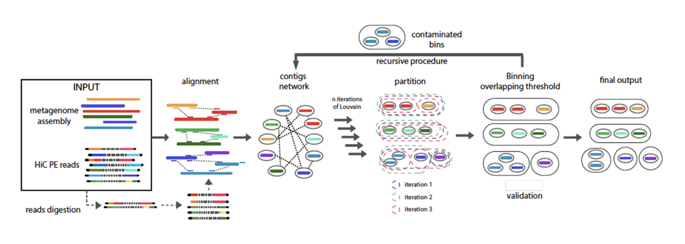

# MetaTOR

[](https://anaconda.org/bioconda/metator)

[](https://github.com/koszullab/metator/actions)
[](https://codecov.io/gh/koszullab/metator)
[](https://opensource.org/licenses/bo-3.0)
[](https://github.com/astral-sh/ruff)
<!-- [](https://metator.readthedocs.io) -->

Metagenomic Tridimensional Organisation-based Reassembly - A set of scripts that streamlines the processing and binning of metagenomic metaHiC datasets.

<p align="center">
  
</p>

1. [Installation](#installation)
   1. [With conda](#with-conda)
   2. [With pip](#with-pip)
   3. [Development version](#development-version)
2. [Usage](#usage)
   1. [Principle of MetaTOR pipeline](#Principle-of-MetaTOR-pipeline)
   2. [Output files](#output-files)
   3. [Contact map](#contact-map)
   4. [metator mge](#metator-mge)
      1. [Principle of mge binning](#Principle-of-mge-binning)
      2. [Usage](#usage-of-mge)
      3. [Output](#output)
3. [Tutorials](#Tutorials)
4. [Contributions](#contributions)
5. [References](#references)
6. [Contact](#contact)
   1. [Authors](#authors)
   2. [Research lab](#research-lab)

## Installation

### With conda

`conda` is the recommended way to install the latest `metator` release:

```sh
conda create -n metator bioconda::metator
```

### With pip

**Note:** although `metator` itself is available from Pypi, several additional libraries are 
not available from Pypi and must be installed separately. Please consider the following 
before installing `metator`:

* Python `3.10` to `3.14` is required.
* The following dependencies should also be locally installed and available in the `$PATH`:
    * [`bowtie2`](http://bowtie-bio.sourceforge.net/bowtie2/index.shtml) or `bwa`
    * [`samtools`](https://www.htslib.org/download/)
    * [`hmmer`](http://hmmer.org/documentation.html)
    * [`prodigal`](https://github.com/hyattpd/Prodigal)

**Warning:** note that if you install `metator` with `pip`, this may upgrade/downgrade 
versions of the above dependencies and may cause conflicts with other softwares.

```sh
# Install bowtie2, bwa, samtools, hmmer and prodigal:
sudo apt update && sudo apt install bowtie2 bwa samtools hmmer prodigal

# Install metator from Pypi
pip3 install metator
```

### Development version 

The development version is managed with [uv](https://docs.astral.sh/uv/). With the
non-Python dependencies listed above installed:

```sh
git clone https://github.com/koszullab/metaTOR
cd metaTOR
uv sync
uv run metator --help
```

See [CONTRIBUTING.md](CONTRIBUTING.md) to run the tests and checks.

## Usage

```sh
metator {network|partition|validation|pipeline|qc|contactmap|metacool|scaffold|pairs|mge} [parameters]
```

A metator command takes the form `metator action --param1 arg1 --param2
arg2 #etc.` `metator --help` lists the actions, `metator action --help`
shows the parameters of an action and `metator --version` the version
number.

There are three actions/steps in the metator pipeline, which must be run in the
following order:

* `network` : Generate metaHiC contigs network from fastq reads, bam, pairs or `.metacool` files and normalize it.
* `partition` : Perform the Louvain or Leiden community detection algorithm many times to bin contigs according to the metaHiC signal between contigs.
* `validation` : Use miComplete to validate the bins, then do a recursive decontamination step to remove contamination.

From a `.metacool` contact map, the three steps take the map as their first argument: `network` reads it,
and `partition` and `validation` update it as `pipeline` does (see
[Step by step on a contact map](#step-by-step-on-a-contact-map)).

There are a number of other, optional, miscellaneous actions:

* `pipeline` : Run all three of the above actions sequentially or only some of them depending on the arguments given. This can take a while.
* `mge` : Perform the binning over mge contigs. A specific section is dedicated to this tool below.
* `contactmap` : Generates a contact map from one bin from the final ouptut of metator, from the pairs files or from the `.metacool` contact map of the run.
* `metacool` : Writes the contact map of all the contigs, grouped by bin, as a `.metacool` file (see [Contact map](#contact-map)). `pipeline` writes it at the end of a run.
* `qc` : Generates some quality check on the input/output of metator, from the pairs files or, for the noise of the library only, from the `.metacool` contact map of the run.
* `scaffold` : Scaffolds a bin from the pairs files.
* `pairs` : Sorts, compresses and indexes pairs files.


### Principle of MetaTOR pipeline



### Output files

The output files will be in the ouput directory given as parmater or in working directory if no paramater were given. Depending on the command used, different files will be in the ouptut:

| Files/Commands | description | network | partition | validation | pipeline |
| - | :-: | :-: | :-: | :-: | :-: |
| alignment_N_for.bam |Bam file of the forward alignment |X|||X|
| alignment_N_rev.bam |Bam file of the reverse alignment|X|||X|
| alignment_N.pairs.pgz |Pairs of the merge alignment|X|||X|
| network.txt |Normalized network of the metaHiC library|X|||X|
| contig_data_network.txt |Information on contigs after network step|X||||
| clustering_matrix_partition.txt |Matrix of clustering from the partition iterations||X|||
| contig_data_partition.txt |Information on contigs after partition step||X|||
| overlapping_micomplete_results.txt |miComplete results summary file from the partition step|||X|X|
| recursive_micomplete_stepN.txt |miComplete results summary file from the recursive step N|||X|X|
| clustering_matrix_validation.txt |Matrix of clustering from the recursive iterations|||X||
| clustering_matrix.txt |Matrix of clustering from the partition and recursive iterations||||X|
| contig_data_final.txt |Information on contigs after whole pipeline|||X|X|
| **cluster_summary.txt** |**Information on the final bins**|||**X**|**X**|
| binning.txt |File with contigs names and their final clustering|||X|X|
| overlapping_clusters |Directory with the fasta of the partition bins||X|X|X|
| recursive_clusters |Directory with the fasta of the recursive bins|||X|X|
| **final_clusters** |**Directory with the fasta of the final bins**|||**X**|**X**|
| metator.metacool |Contact map of the contigs, grouped by bin (`<prefix>.metacool` with `--prefix`); a run from a map updates that map instead (see [Starting from a contact map](#starting-from-a-contact-map))||||X|
| metator.mmetacool |With several libraries, the contact map of each library (`<prefix>.mmetacool` with `--prefix`)||||X|

**Bam alignment files**
For the bam alignments files, only the aligned reads are kept and the bam are sorted by name. The N value correspond to the id (order of the given fastq started at 0)

**Pairs aligment files**
This format is used to store the relevant information of mapping of the merged alignment. It's a s The N value correspond to the id (order of the given fastq started at 0). It is a tab-separated format holding informations about Hi-C pairs. It has an [official specification](https://github.com/4dn-dcic/pairix/blob/master/pairs_format_specification.md) defined by the 4D Nucleome data coordination and integration center. Here we kept 7 columns readID-chr1-pos1-chr2-pos2-strand1-strand2.

**Network file**
This is a tsv file of the network with edgelist form: Id of the first contig, id of the second contig and the weigth of edge normalized.

**Contig data files**
These are the files with all the informations from the contigs:
|ID|Name|Size|GC_content|Hit|Shotgun_coverage|Restriction_site|Core_cluster_ID|Core_cluster_contigs|Core_cluster_size|Overlapping_cluster_ID|Overlapping_cluster_contigs|Overlapping_cluster_size|Recursive_cluster_ID|Recursive_cluster_contigs|Recursive_cluster_size|Final_cluster|
|:-:|:-:|:-:|:-:|:-:|:-:|:-:|:-:|:-:|:-:|:-:|:-:|:-:|:-:|:-:|:-:|:-:|
|1|NODE_1|642311|38.6876450815882|3837|41.1565|2006|1|65|2175226|1|396|6322353|1|52|2158803|MetaTOR_1_1|
|2|NODE_2|576356|30.235826468363303|1724|24.509|1256|2|40|1735419|2|401|735419|0|-|-|MetaTOR_2_0|
|3|NODE_3|540571|42.305266098255366|2188|14.5855|3405|3|127|6409484|3|431|13615480|1|112|6385126|MetaTOR_3_1|

They have to have the header when they are use as input but the order of the columns nd if they are others columns doesn't matter when they are used as input files.
Depending on which step of the pipeline have been launch they just have some of these columns:

* `contig_data_network.txt`: columns: ID, Name, Size, GC content, Hit, Shotgun_coverage and Restriction Site only.
* `contig_data_partition.txt`: The same as the previous with the information of core bins and overlapping bins.
* `contig_data_final.txt`: All the columns.

The shotgun coverage will be filled only if the depth.txt file is given, otherwise it will be filled with `-`. This column is only necessarry for the *abundance* and the *theoritical_hit* normalization. The restriction will also be filled with `-` if no enzyme are given. This column is only necessary for the *RS* and the *theoritical_hit* normalization. A run from a contact map reads both columns from the map when the options are not given (see [Starting from a contact map](#starting-from-a-contact-map)).
Moreover, if the contig is not binned (no HiC reads mapped on it) all the columns with binning information will be filled with `-`, and if a bin is not recursively decontamined because it's smaller than the size threshold or it doesn't have any contamination the recusive bin information will be filled `0`, `-`, `-`. Finally, if the bin is not in a final bin, it will be annotated `ND` in the last column (for not determined).

**clustering matrix files**
The clustering matrix files are at the `.npz` format which is a compresed foramt for sparsed matrix. This sparsed matrix contains the ratio of time each pairs of contigs are clusterize together by the algorithm of clustering (either Louvain or Leiden). The partition matrix contains the information for the partition step, the recursive one for the recursive step and the general one is the mean of both matrices. Be careful the index of the contigs are **zero-based** and not one-based as in the contig data file.

It's possible to read them in python using the `scipy.sparse.load_npz()` function. If the users wants a tsv file instead, he or she could load the matrix in python using load_npz and make sure to transform the matrix in the `scipy.sparse.coo_matrix` function and used the function from metator `metator.io.save_sparse_matrix` to save it as tsv file.

**binning.txt file**
This is a tsv file with two columns: the contig name and the final were the contig is. It only contains contigs which are binned. It could be use a an input to import a binning results in anvio.

**Bin summary file**
This is the summary of the data of the final bins build with all the step of metator (GC content, number of contigs, N50, HiC abundancy ...). It also contains the data from the final miComplete evaluation (Present Markers, Completeness, Redundancy, Weighted completeness	and Weighted redundancy).

||Length|GC-content|Present_Markers|Completeness|Redundancy|Weighted_completeness|Weighted_redundancy|Contigs|N50|L50|N90|L90|CDs|recursive|step|parent|HiC_abundance|
|:-:|:-:|:-:|:-:|:-:|:-:|:-:|:-:|:-:|:-:|:-:|:-:|:-:|:-:|:-:|:-:|:-:|:-:|
|metator_00031_00000|6169839.00|57.47|103.00|0.98|1.01|0.98|1.02|153.00|287729.00|8.00|40103.00|27.00|5707.00|False|0||3.3423|
|metator_00001_00000|4695682.00|42.58|103.00|0.98|1.03|0.99|1.08|326.00|71792.00|22.00|13441.00|85.00|4141.00|False|0||1.9909|
|metator_00030_00001|5094713.00|45.69|105.00|1.00|1.10|1.00|1.13|44.00|428652.00|5.00|99776.00|15.00|4726.00|False|1|metator_00030_00000|0.3708|

### Contact map

`metator pipeline` writes the contact map of all the contigs, grouped by bin, as `metator.metacool` in
the output directory (`<prefix>.metacool` with `--prefix`). It reads the pairs files into the map once,
as soon as it has them: the map of the contigs, in no bin yet (every contig in `__unbinned__`, the
longest first), with their contacts, the contact statistics that metacooler measures on the reads and
what metaTOR measures on the assembly (`GC_content`, and `Shotgun_coverage` and `Restriction_site` with
`--depth` and `--enzyme`). A run with one library reads its network from this map, as a run from a map
does (see [Starting from a contact map](#starting-from-a-contact-map)): `network.txt` and
`contig_data_network.txt` are those of its pairs files, byte for byte, as `pipeline` counts every pair,
whatever the input. It still writes `network_0.txt`, the network of its library, as
a copy of `network.txt`: its pairs files give the same bytes. A run with several libraries builds the map
of each library, the entries `library_0`, `library_1`... of `metator.mmetacool` (`<prefix>.mmetacool`:
maps of the contigs in no bin, without the columns measured on the assembly, which they stay at the end),
and the map of their sum, `metator.metacool`, merged from them (their contacts and contact statistics
summed; its counts are stored as 64-bit integers): it reads `network.txt` from the sum, and the network
of each library (`network_N.txt`) and `hit_data_alignment.txt` from its map, the files that its pairs
files give, byte for byte. So a pair on a contig that the assembly lacks is left out, as metacooler warns
(it counts them, with the pairs that have a read past the end of their contig), and the run goes on,
whatever the number of libraries. At the end of the run, `pipeline` writes the map of the bins over the
map of the contigs, from the final tables, with `metacooler reassign`; `--no-metacool` removes the maps
instead (the `.mmetacool` collection too). It is written through a fresh file, which holds none of the space that the edits making it leave behind, so a map updated in place does not grow with each run. A run that started from a contact map updates that map in place (or writes `--output-map`, see
[Starting from a contact map](#starting-from-a-contact-map)). The map also stores the clustering rounds of the run (the
overlapping, recursive and final clusters, with their contigs), which the run writes as `clusters.txt` and
`cluster_members.txt` too. `metator metacool` writes the same file from the pairs files,
`contig_data_final.txt` and `cluster_summary.txt` of a run, but for the clustering rounds, which it does not store, the history that it stores (the
`annotate` and `reassign` keys of its metadata) and the type of its counts with several libraries (64-bit
integers, which `metator metacool` stores as 32-bit ones):

```sh
metator metacool -c contig_data_final.txt -b cluster_summary.txt -o sample.metacool alignment_0_sorted.pairs.gz alignment_1_sorted.pairs.gz
```

or, for a run that started from a contact map, from that map, as `metator pipeline MAP` and `metator
validation MAP` write it (see [Step by step on a contact map](#step-by-step-on-a-contact-map)), but
for the clustering rounds: for a run whose `partition` and `validation` were not given the map, for
example (the map keeps its assembly name, so `--assembly-name` is refused):

```sh
metator metacool -c contig_data_final.txt -b cluster_summary.txt -o binning.metacool sample.metacool
```

A `.metacool` file is the contact map format of [metacooler](https://github.com/js2264/metacooler): a
[cooler](https://github.com/open2c/cooler) whose chromosomes are the contigs, grouped by genome. `cooler`
and the tools built on it read it as any `.cool` file, and `metacooler` adds the genomes:

* one bin per contig, and one genome per final bin. The contigs that are in no final bin (`ND` in
  `contig_data_final.txt`) are kept, with all their contacts, in the `__unbinned__` genome: all the
  contigs, for a run with no final bin. The contigs come genome by genome, the longest first;
* the contacts: each pair whose two ends lie on contigs of the assembly is one contact between these
  two contigs (an intra-contig contact when both ends are on the same contig). These are the raw
  contacts of the pairs files, without the filters and the normalization of the network, and those of
  several libraries are summed;
* the genomes table holds the columns of `cluster_summary.txt` (completeness, redundancy, Hi-C and
  shotgun abundances...), next to the length, contig and bin counts of each genome and the contact
  statistics that metacooler computes while reading the pairs. Each row of `cluster_summary.txt` must
  have as many fields as its header, as metaTOR writes it: metacooler refuses a table whose values it
  cannot match with their columns;
* the contigs table (the chromosomes table of `cooler`) holds what metaTOR measured on each contig:
  the `GC_content`, `Hit`, `Shotgun_coverage` and `Restriction_site` columns of
  `contig_data_final.txt`, except those that are `-` on every contig (`Shotgun_coverage` of a run
  without `--depth`, `Restriction_site` of a run without `--enzyme`, when the map that a run starts
  from does not give them either), and the contact statistics that
  metacooler computes within each contig (`qc_intra_contig_short`, `qc_intra_contig_long`). The bins
  of the contigs are not stored there: the genome of a contig is its final bin;
* the metadata of the file hold the version of metaTOR, the command line and its parameters, under
  the `metator` key.

```python
import cooler
import metacooler

clr = cooler.Cooler("metator.metacool")
mc = metacooler.MetaCooler("metator.metacool")
mc.genomes  # one row per bin, with the columns of cluster_summary.txt
mc.contigs  # one row per contig, with its GC content and Hi-C hits (see above)
```

The contig and bin names must be ASCII, as `cooler` reads them as ASCII text. No bin may be named as
metacooler marks a contig in no bin (`NA`, `NaN`, `N/A`, `N/D`, `-1` or `__unbinned__` in any case,
and `nd` in any case other than `ND`, which marks a contig in no bin): metacooler would put its contigs
in `__unbinned__`. metaTOR's own bin names never
are, but those of a hand-edited `contig_data_final.txt` can be. When the map of the clusters cannot
be written, `metator pipeline` and `metator metacool` log the reason as an error and stop with it;
`pipeline` keeps its other outputs. `pipeline` removes a map that an
earlier run left in the output directory before it builds the map of the contigs in its place
(`--no-metacool` or not), as it no longer matches the bins: from then on, the map there is this run's,
or there is none. So a run from reads, alignments or pairs refuses, before any work, an input that is
that map (or a symbolic link to it or from it), and, from pairs, a contact map: start from a map by
giving it as the first argument. A map of the contigs that cannot be built (for example, from pairs files that
metacooler cannot read, see below) stops the run before its network, `--no-metacool` or not, whatever the
number of libraries: the reason is logged as an error, in the log file of the run, and no map is left.
When the map of the bins cannot be written over it (for example, from a misaligned `cluster_summary.txt`),
the map of the contigs stays, in no bin. So it does when the run stops with an error once it is built
(in the partition or the validation, for example), `--no-metacool` or not: a new run can start from it,
without aligning the reads again, with `metator pipeline <outdir>/metator.metacool`
(`<outdir>/<prefix>.metacool` with `--prefix`) and `-F`, which replaces the bin directories that the
stopped run left in the output directory; `--scaffold` is not available then (see
[Starting from a contact map](#starting-from-a-contact-map)).

`pipeline` checks what the map of the contigs needs before any work. Its contig names must be ASCII: a
run that is not from a map refuses an assembly with other contig names, which it gives, before it builds
the index of the assembly or aligns a read; rename these contigs to ASCII names, in the assembly and in
the alignments or pairs files made from it (and build its index again, for an assembly given as an
index). metacooler, which builds the map, and metaTOR, which reads the pairs files of `--scaffold`, both
find the compression of a pairs file from its first bytes, whatever its name: metacooler reads plain,
gzip, bzip2, zstd and LZ4 files, metaTOR plain, gzip, bzip2 and zip ones. So a run from pairs refuses,
before any work, an empty pairs file; a zip archive, which metacooler cannot read; and, with
`--scaffold`, a zstd or LZ4 file, which metaTOR cannot read: decompress the file, or compress it with
gzip. zstd and LZ4 files work without `--scaffold`: the networks come from the maps. metacooler also
needs the same number of fields on every row of a pairs file; its header lines (those that start with
`#`) may come anywhere, so pairs files of one assembly concatenated with `cat` are one library. Give the
pairs files of several libraries comma-separated, one file per library. A run from pairs that metacooler
cannot read stops with the reason and these needs.

#### Starting from a contact map

`metator network` and `metator pipeline` can build the network from a `.metacool` contact map of the
contigs of the assembly, instead of reads, alignments or pairs: the map is their first argument (one
file, or an entry of a `.mmetacool` collection, `file.mmetacool::entries/<name>`), in place of `-1`,
`-2` and `--start`:

```sh
metator pipeline sample.metacool -a assembly.fa -d depth.txt -e DpnII -o binning
```

The map can have any bin size, from one bin per contig (as the maps written by metaTOR) to fixed bins.
Its contigs must be contigs of the assembly, with their lengths: the contig ids and GC contents still
come from the assembly. The restriction sites and the shotgun coverages come from the `Restriction_site`
and `Shotgun_coverage` columns of the map, which metaTOR stores in the maps it writes with `--enzyme`
and `--depth`, so that a run from such a map needs neither: the same network and tables, byte for
byte (with pandas 2, for coverages of at most 15 significant digits and 15 digits after the decimal
point, as jgi's depth files have: metacooler can store a longer one one unit off in its last place,
which changes the last digits of the contig data files and of a network normalized by it, and has
`--depth` warn that it replaces the map's value). `--enzyme` and `--depth` fill in a
column that the map lacks, and replace one that it has (a warning counts the contigs whose value
differs); the map of the bins stores what the run used, and the metadata of the map that `pipeline`
writes which columns it read (`columns_from_map`). A column is read only if it gives every contig of the assembly a value (a number
of restriction sites, plus one, of at least 1; a coverage of at least 0; a contig of no length, which
no map holds, gets 1 and 0): one with no valid value, such as one of `-`, as metaTOR writes what it did
not measure, is as no column, and one that lacks some contigs is not read, with a warning that names
them, and is not carried into the map of the bins. A normalization that needs a column that neither the
map nor the options give is refused before the run replaces anything: before any work when the map has
no such column, once the assembly is read when the column lacks contigs. The map may lack contigs of
the assembly,
as a map made with a contig filter does (`metacooler create pairs --filter 'contigs.length >= 1kb'`, for
example, which also leaves out the pairs with a read on the contigs that it drops): those get no
contacts and no hits, as contigs that no read maps to, and the log file says how many they are. The
contacts between two contigs are those between their bins, and the hits of a contig those of its bins,
so that the network and `contig_data_network.txt` are those of the pairs the map holds, byte for byte,
as both count every pair. A map that cannot give this network (contigs that are not in the assembly or that have
other lengths, or both triangles of the matrix stored) stops the run with an error, whose reason is
logged in the log file of the run. The libraries of a map are already summed: no `network_N.txt` is
written. `pipeline --scaffold`, which reads the pairs files, is refused. The heatmap of the network of the final clusters
(`plot/network_heatmap.png`) is drawn from the map, as for every run of `pipeline`, whatever it started
from (see [Plots](docs/guides/binning.md#plots)).

At the end of such a run, `pipeline` updates the input map in place with the map of its clusters,
with `metacooler reassign` (`--output-map FILE` writes it to FILE instead, and leaves the input map
as it was):

* the bins and contacts of the input map, at its bin size; one genome per final bin, `__unbinned__`
  for the other contigs; the contigs grouped genome by genome, the longest first, whatever the order
  of the input map, as in the map of a run from pairs;
* the genomes table holds the columns of `cluster_summary.txt`, and the contigs table the columns of
  `contig_data_final.txt` described above, last, as in the map of a run from pairs: they replace those
  that the input map had (the map of an earlier binning, for example). With no final bin, the genome
  columns of the input map are dropped;
* the contact statistics (the `qc` block of the metadata and the `qc_*` columns of the genomes and
  contigs tables) are those of the input map, when it has them, carried over to the bins: metacooler
  keeps the counts within each contig (measured on the reads, for a map made from pairs files) and
  counts the contacts between contigs again. A map written by metacooler 0.2.0 holds no count per
  contig: its statistics are computed again from the pixels, which hold no read positions (at one bin
  per contig, every contact within a contig then counts as short-range, and the numbers of pairs read
  and left out are lost, which metacooler warns about for a map made from pairs files);
* the assembly name and the history of the commands are those of the input map (`unknown` when
  `metacooler create pairs` had no `--assembly-name`).

On a map with one bin per contig of all the contigs of the assembly, the map of the bins is the map
that a run from the pairs of the map writes, contact statistics included, but for its assembly name and
its history. The new map is written next to the map it replaces and checked (`metacooler`'s full
validation) before it replaces it; when it cannot be written, the run stops with the reason, and the
map is left as it was, as it is when the run stops for any other reason (Ctrl-C included). A symbolic
link is replaced, not its target (an input map stored elsewhere, for example). A run from an entry of a
`.mmetacool` collection needs `--output-map`, and a FILE that exists is replaced only with `-F`. While
a run writes a map, `<map>.lock` holds it: a second run that would write the same map stops before any
work, naming the run that holds it (a lock that a run left behind on the same host when it died is
removed, with a warning). A run stopped by Ctrl-C or SIGTERM (a job scheduler's time limit) cleans up after
itself; one killed outright (`kill -9`) can leave its lock, and the files of the map it was writing
next to the map, which can be deleted: `.<map>.<random>.tmp` or `.<map>.<random>.tmp.<random>.fresh`,
and those that metacooler and cooler write while it is written (`.<map>.<random>.tmp.partial`,
`.<map>.<random>.tmp.partial.__writing__`, `tmp<random>.multi.cool`). The map is left as it was.

#### Step by step on a contact map

The three steps of `pipeline MAP` take the map as their first argument too. Run one after the other on
one map, they read and update it as `pipeline MAP` does, and write the map that it writes from the same
clusters, but for the date the map was written and the command line and parameters that it stores (those
of `validation`). Louvain draws random numbers: two runs give the same clusters only from the same random
stream, as the tests check in one process, so steps run as separate commands differ from `pipeline` as
two `pipeline` runs do. `partition MAP` on a map that holds the clusters of an earlier run replaces its
clustering rounds with its own, and leaves its genomes, contigs and the `metator` key of its metadata as
the earlier run wrote them, until `validation MAP` writes the new ones:

```sh
# 1. The network: network.txt and contig_data_network.txt. The map is only read.
metator network sample.metacool -a assembly.fa -d depth.txt -e DpnII -o binning
# 2. The partition: overlapping_clusters/ and contig_data_partition.txt. The map stores the overlapping clusters.
metator partition sample.metacool -a assembly.fa -c binning/contig_data_network.txt -n binning/network.txt -o binning
# 3. The validation: the final clusters. The map becomes the map of the clusters.
metator validation sample.metacool -a assembly.fa -c binning/contig_data_partition.txt -n binning/network.txt \
    -f binning/overlapping_clusters -o binning
```

`partition MAP` stores its overlapping clusters that reach `--size`, those of `overlapping_clusters/`, with
their contigs, as the round `overlapping` of the clustering rounds of the map, in place of the rounds
that it held (without the columns of miComplete, which the validation runs), and leaves the genomes
and contigs tables of the map as they were. `validation MAP` writes the map of the clusters, as
`pipeline MAP` does at its end, with every round (`overlapping`, `recursive_<k>`, `final`). Both write
the map as `pipeline MAP` does: in place, through a map written next to it and validated in full, or to
`--output-map FILE`, which leaves the map as it was (give the next step that FILE; a run from an entry
of a `.mmetacool` collection needs it). They lock the map while they run, and refuse what `pipeline
MAP` refuses (a map that is not there or that metacooler cannot open, a lock that another run holds, a
FILE that exists without `-F`...), a map that is no map of the contigs of their contig data (`-c`:
other contigs or lengths), an `--output-map` that is one of their inputs, and an invalid `--prefix`,
before any work and before `-F` replaces the directories of clusters of an earlier run. Without the map,
`partition` and `validation` run as before, but for an invalid `--prefix`, now refused before `-F`
replaces those directories.

#### qc, contactmap and mge on a contact map

`qc` and `contactmap` take the `.metacool` contact map of the run in place of its pairs files, for what a
map gives, the contacts between contigs, which are those of the pairs it was made of: `metator qc MAP`
measures the noise of the library (the contacts within contigs, within MAGs and between MAGs of the
high-quality MAGs, the noise contact ratio and the noise score), the numbers that `qc` measures from the
pairs files (written in the upper triangle, as metaTOR's alignment writes them), but not the events of the
pairs within a contig (uncuts, loops, weirds, informative contacts), which need the positions and strands
of their reads; `metator contactmap MAP` writes the contact map of a cluster as `metacooler extract`
writes it, `<name>.cool`, at the bins of the map (one per contig), where hicstuff maps the restriction
fragments from the pairs files. Their options that need the read positions are refused then
(`qc --threshold` and `--plot`, `contactmap --filter`, `--pcr-dup` and a `--mat-fmt` other than `cool`), and
`--enzyme` is not used. `mge` reads the pairs files, as it counts the contacts within each MGE contig
between reads more than 1 kb apart, which a map does not tell, but `metator mge ... --map MAP` stores its
MGE clusters in the map: as the round `mge` of its clustering rounds, with the columns of
`mges_cluster_summary.tsv` and the contigs of each cluster, after the rounds of the binning run, which are
kept, and in place of the round `mge` of an earlier run; a run that replaces the clusters of the map drops
it, with a warning. The genomes and contigs tables of the map, the final MAGs, are left as they were. The
map is written as `partition MAP` writes it (in place, or to `--output-map FILE`), and refused as it
refuses it, before any work.

#### From hicstuff to metaTOR through metacooler

A map to start from can be made from the pairs files of
[hicstuff](https://github.com/koszullab/hicstuff), with no binning yet:

```sh
# 1. Align each library, without -f or -D: they leave out pairs (3C events that hicstuff
#    filters, PCR duplicates) that metaTOR's own alignment keeps.
hicstuff pipeline -g assembly.fa -e DpnII -o hicstuff_L1 -P L1 L1_R1.fq.gz L1_R2.fq.gz
hicstuff pipeline -g assembly.fa -e DpnII -o hicstuff_L2 -P L2 L2_R1.fq.gz L2_R2.fq.gz
# 2. One map of both libraries, one bin per contig, every contig in __unbinned__ (no --contigs).
samtools faidx assembly.fa
awk -v OFS='\t' '{print $1, 0, $2}' assembly.fa.fai > contigs.bed
metacooler create pairs --pairs hicstuff_L1/L1.valid_idx.pairs.gz --pairs hicstuff_L2/L2.valid_idx.pairs.gz \
    --bins contigs.bed --no-ps --assembly-name assembly -o sample.metacool
# 3. Cluster the contigs: sample.metacool becomes the map of the clusters, in place.
metator pipeline sample.metacool -a assembly.fa -e DpnII -o binning
```

* `--bins 1000` makes bins of 1 kb instead, taking the lengths of the contigs from the `#chromsize`
  lines of the pairs files of hicstuff, or from `--fasta`;
* `--no-ps`: otherwise metacooler also writes `sample.ps.tsv`, a P(s) table of the single
  `__unbinned__` genome;
* `--assembly-name`: otherwise the assembly of the map, and of the map of the bins, is `unknown`;
* `--contig-order fasta` keeps the contigs in the order of the assembly (by default, the longest
  first). It needs `--fasta` or the `#chromsize` lines of the pairs files: metacooler does not keep
  the order of a BED file. `--fasta` writes the index of the assembly (`.fai`) next to it, in a
  directory that must be writable.

### metator mge

#### Principle of mge binning


#### Usage of mge

`metator mge` : given a list of contigs previously identified as MGE, this command will bin the specific given contigs and return a fasta files as well as a summary file. 

With `--map MAP`, the MGE clusters are also stored in the `.metacool` contact map of the run, as the round `mge`
of its clustering rounds (see [qc, contactmap and mge on a contact map](#qc-contactmap-and-mge-on-a-contact-map)).

#### Output

**mges_binned.fa**
fasta file of the mge obtained after the binning step.

**mges_cluster_summary.tsv**

This is the summary of the data of the final mge bins build with the specific command mge.

|BinName|BinLength|GC|Hit|BinningScore|ContigsNumber|Contigs|MetagenomicBin|AssociationScore|AssociatedBins|
|:-:|:-:|:-:|:-:|:-:|:-:|:-:|:-:|:-:|:-:|
|MetaTOR_MGE_00064|30610.00|68.93|18383.00|1.20|2.00|NODE_8199_len_17842,NODE_10116_len_12768|None|NA|NA|
|MetaTOR_MGE_00105|23587.00|37.36|2662.00|NA|1.00|NODE_10949_len_23587|None|NA|NA|
|MetaTOR_MGE_00106|2872.00|64.48|10.00|NA|1.00|NODE_10953_len_2872|None|NA|NA|

## Tutorials

different tutorials are available to explain how to use metator:

* metator pipeline: [here](docs/guides/pipeline.md)
* [Anvio](https://merenlab.org/software/anvio/) manual curation of the contaminated bins: [here](docs/guides/curation.md).
* Visualization of the MAGs with the contactmap modules of MetaTOR: [here](docs/guides/visualisation.md).


## Contributions 

We welcome contributions to the project. Please refer to the [CONTRIBUTING.md](CONTRIBUTING.md) file for more information.

## References

* [Metagenomic chromosome conformation capture (meta3C) unveils the diversity of chromosome organization in microorganisms](https://www.ncbi.nlm.nih.gov/pmc/articles/PMC4381813/), Martial Marbouty, Axel Cournac, Jean-François Flot, Hervé Marie-Nelly, Julien Mozziconacci, and Romain Koszul. eLife, 2014.
* [Scaffolding bacterial genomes and probing host-virus interactions in gut microbiome by proximity ligation (chromosome capture) assay](https://www.ncbi.nlm.nih.gov/pmc/articles/PMC5315449/), Martial Marbouty, Lyam Baudry, Axel Cournac, and Romain Koszul. Science Advances, 2017.
* [MetaHiC phage-bacteria infection network reveals active cycling phages of the healthy human gut](https://elifesciences.org/articles/60608), Martial Marbouty, Agnès Thierry, Gaël A Millot, Romain Koszul. eLife, 2021.
* [Phages with a broad host range are common across ecosystems](https://hal.science/pasteur-05269627), Amaury Bignaud, Devon Conti, Agnès Thierry, Jacques Serizay, Karine Labadie, Julie Poulain, Olivia Cheny, Maritrini Colón-González, Laurent Debarbieux, Marianna Guerrero-Osornio, Sophie Helaine, Peter Hill, Gwenaelle Le Tinier, Gael A Millot, Lucia Morales, Andrés Parada, Nadia Riera, Gregorio Iraola, Romain Koszul & Martial Marbouty.
Nature Microbiology, 2025

## Contact

### Authors

* martial.marbouty@pasteur.fr
* jacques.serizay@pasteur.fr
* romain.koszul@pasteur.fr
* amaury.bignaud@pasteur.fr
* lyam.baudry@pasteur.fr
* thfoutel@pasteur.fr

### Research lab

[Spatial Regulation of Genomes](https://research.pasteur.fr/en/team/spatial-regulation-of-genomes/) (Institut Pasteur, Paris)
