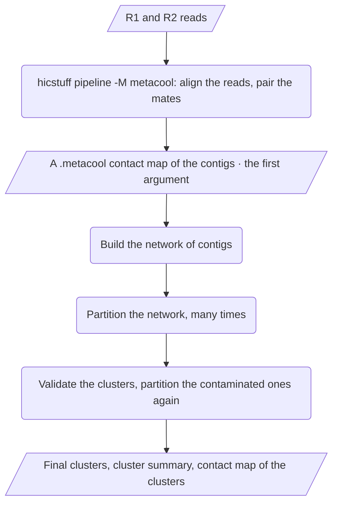

# Concepts

How metaTOR clusters contigs, and the terms the rest of the documentation
uses. For the layout of each file, see [File formats](formats.md).

## The signal

A metaHiC (or meta3C) library cross-links the cells of a microbial community,
cuts their DNA with a restriction enzyme, ligates ends that lie close in
space, and sequences the junctions as read pairs. Most ligations join DNA of
the same cell, so the two mates of a pair fall on contigs of the same genome
far more often than on contigs of different genomes. Grouping the contigs
that are often joined recovers the genomes.

## The pipeline

`metator pipeline` takes the contact map of the contigs (a `.metacool` file)
and runs three steps. hicstuff makes the map from the reads; metacooler, or
`metator pipeline` itself, can also make it from pairs or BAM files (see
[The inputs of a run](cli.md#inputs)).

Each step is also a command (`metator network`, `metator partition`,
`metator validation`); see
[Running the pipeline](guides/pipeline.md#running-the-steps-one-by-one).

## Contig data and hits

metaTOR first measures each contig of the map: size, GC content, number of
restriction fragments (with `--enzyme`), shotgun coverage (with `--depth`), and
**hits**, the number of contact ends that lie on it (a contact within the
contig counts twice). This **contig data** is stored in the contigs table of
the map, and the later steps add the clusters of each contig to it.

## The network

A read pair whose mates lie on two different contigs is a contact between
them. The contigs are the nodes of the network; an edge holds the contacts
between two contigs, **normalised** so that large or abundant contigs do not
attract all the others. The default, `empirical_hit`, divides the contacts by
the geometric mean of the hits of the two contigs. The network is stored in
the map. [Building the network](guides/network.md) lists the other
normalisations.

## Partition: core and overlapping clusters

The [Louvain](https://en.wikipedia.org/wiki/Louvain_method) algorithm (or
[Leiden](https://en.wikipedia.org/wiki/Leiden_algorithm), with
`--algorithm leiden`) splits the network into communities: groups of contigs
more connected to each other than to the rest. Both algorithms are
randomised, so metaTOR runs one many times (`--iterations`, 100 by default)
and combines the runs:

- **Core clusters**: contigs that fall in the same community at every
  iteration.
- **Overlapping clusters**: core clusters that fall together in at least
  `--overlap` percent of the iterations (80% by default).

Both are stored in the map, as the clustering rounds `core` and
`overlapping`. The overlapping clusters of at least `--size` bp (500 kb by
default) go on to validation.

## Validation and recursive clusters

[miComplete](https://pypi.org/project/micomplete/) checks each cluster by
counting single-copy marker genes (found with Prodigal and HMMER, through
pyrodigal and pyhmmer): their share gives the **completeness** of the
cluster, and their copies its **redundancy**.

A cluster with a weighted completeness of at least 33% and a contamination,
(redundancy − 1) / completeness, of 5% or more is partitioned again on its
own contigs, with `--rec-iter` iterations (10) and an overlap of
`--rec-overlap` percent (90). Its parts, the **recursive clusters**, replace
it if the most complete part keeps enough of its completeness. This repeats
until no cluster is replaced, for at most 9 steps.

The **final clusters** are the overlapping clusters that were not split, and
the recursive clusters of those that were. A name gives both:
`metator_00012_00003` is recursive cluster 3 of overlapping cluster 12;
`metator_00001_00000` is overlapping cluster 1, not split. Contigs in no final
cluster are marked `ND` (not determined).

## Cluster quality

The log and the plot `plots/bins_size_distribution.pdf` sort the final
clusters into five classes, by weighted completeness and contamination
(weighted redundancy − 1):

| Class | Completeness | Contamination |
|---|---|---|
| HQ (high-quality) MAGs | ≥ 90% | ≤ 5% |
| MQ (medium-quality) MAGs | ≥ 70% | ≤ 10% |
| LQ (low-quality) MAGs | ≥ 50% | ≤ 10% |
| Contaminated potential MAGs | ≥ 50% | > 10% |
| Other clusters | < 50% | |

The recursive partition uses another measure of contamination, relative to
completeness: (weighted redundancy − 1) / weighted completeness.

## The contact map of the clusters

A run ends by writing the contact map of all the contigs, grouped by cluster,
to its output directory: a [metacooler](https://github.com/js2264/metacooler)
`.metacool` file, a [cooler](https://github.com/open2c/cooler) whose contigs
are grouped into one genome per final cluster. The input map is left
unchanged, unless `--inplace` is given. See
[The contact map of the clusters](guides/metacool.md).
