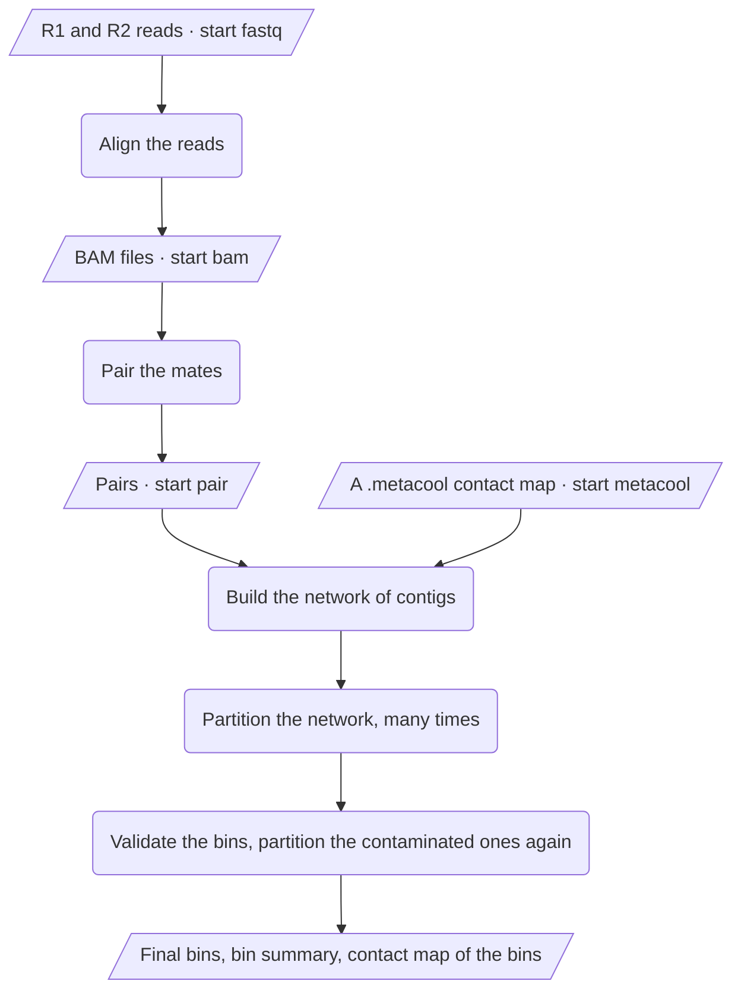
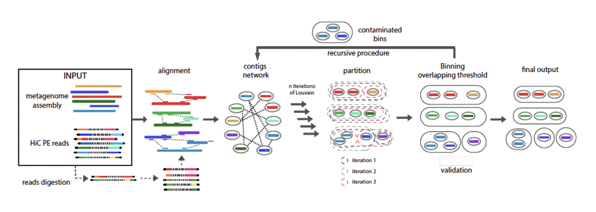

# Concepts

This page explains how metaTOR bins contigs, and the words the rest of the
documentation uses for it: hits, the network, core and overlapping bins,
validation and recursive bins. For the layout of each file, see
[File formats](formats.md).

## The signal

A metaHiC (or meta3C) library is made by cross-linking the cells of a
microbial community, cutting their DNA with a restriction enzyme, ligating
the ends that lie close in space, and sequencing the junctions in pairs. Most
ligations join two pieces of DNA of the same cell: aligned on the assembly,
the two mates of a read pair fall on contigs of the same genome far more often
than on contigs of different genomes. Grouping the contigs that are often
joined finds the genomes.

## The pipeline

`metator pipeline` runs these steps (rounded) in order, and writes the files
(slanted) between them. `--start` starts it from one of those files instead
of from the reads:

The three steps are also three commands, `metator network`,
`metator partition` and `metator validation`, run one after the other; see
[Running the pipeline](guides/pipeline.md#running-the-steps-one-by-one).

## Contig data and hits

metaTOR first measures every contig of the assembly: its size, its GC
content, its number of restriction fragments (with `--enzyme`), its shotgun
coverage (with `--depth`), and its number of **hits**, the ends of the pairs
that lie on it (a pair within the contig counts twice). These go to the **contig data** table, which every step reads and
extends with the bins of the contig.

## The network

Each read pair with its two mates on two different contigs is a contact
between them. The contigs are the nodes of the network, and its edges hold
the contacts between two contigs, **normalised** so that a large or abundant
contig does not attract every other one. The default normalisation,
`empirical_hit`, divides the contacts between two contigs by the geometric
mean of their hits. [Aligning reads and building the network](guides/network.md)
lists the other normalisations.

## Partition: core and overlapping bins

The network is partitioned into communities, groups of contigs more
connected with each other than with the rest, with the
[Louvain](https://en.wikipedia.org/wiki/Louvain_method) algorithm (or
[Leiden](https://en.wikipedia.org/wiki/Leiden_algorithm), with
`--algorithm leiden`). Both are randomised: two runs do not give the same
communities. metaTOR runs the algorithm many times (`--iterations`, 100 by
default) and combines the runs:

- **Core bins** are the contigs that fall in the same community at every
  iteration.
- **Overlapping bins** merge the core bins that fall together at most
  iterations: in at least `--overlap` percent of them (80% by default).

The overlapping bins of at least `--size` base pairs (500 kb by default) are
written as FASTA files, in `overlapping_bin/`: they are the bins to validate.

## Validation and recursive bins

Each bin is checked with [miComplete](https://pypi.org/project/micomplete/),
which counts single-copy marker genes, found by Prodigal and HMMER (through
pyrodigal and pyhmmer): their
share gives the **completeness** of the bin, and their copies its
**redundancy**. A bin with a weighted completeness of at least 33% whose
contamination, (redundancy − 1) / completeness, reaches 5% is partitioned
again, on the network of its own contigs, with `--rec-iter` iterations (10)
and an overlap of `--rec-overlap` percent (90). Its parts, the **recursive
bins**, replace it when the most complete of them keeps enough of its
completeness; the step repeats until no bin is replaced, for 9 steps at most.

The **final bins** are the bins left: the overlapping bins that were not
split, and the recursive bins of those that were. A final bin is named after
both: `metator_00012_00003` is recursive bin 3 of overlapping bin 12, and
`metator_00001_00000` an overlapping bin that was not split. The contigs in no
final bin are marked `ND`, not determined.

## Bin quality

At the end of the validation, the log counts the final bins in five classes,
from their weighted completeness and their contamination, the weighted
redundancy − 1, and the plot `plot/bins_size_distribution.png` shows them:

| Class | Completeness | Contamination |
|---|---|---|
| HQ (high-quality) MAGs | ≥ 90% | ≤ 5% |
| MQ (medium-quality) MAGs | ≥ 70% | ≤ 10% |
| LQ (low-quality) MAGs | ≥ 50% | ≤ 10% |
| Contaminated potential MAGs | ≥ 50% | > 10% |
| Others | < 50% | |

The recursive partition measures the contamination of a bin otherwise,
relative to its completeness: (weighted redundancy − 1) / weighted
completeness.

## The contact map of the bins

At the end of a run, metaTOR writes the contacts of all the contigs, grouped
by bin, as a `.metacool` file: the contact map format of
[metacooler](https://github.com/js2264/metacooler), a
[cooler](https://github.com/open2c/cooler) whose contigs are grouped into
genomes, one per final bin. A run can also start from such a map, made from
the pairs files of [hicstuff](https://koszullab.github.io/hicstuff/), for
instance. See [The contact map of the bins](guides/metacool.md).
