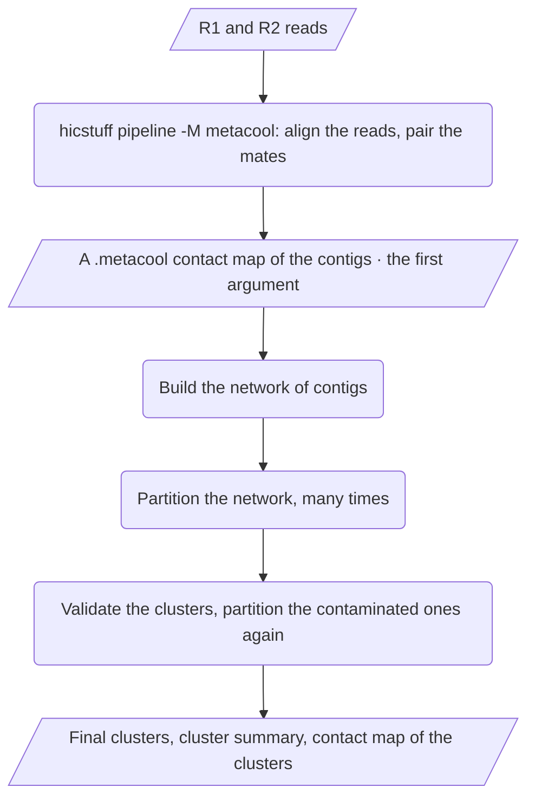

# Concepts

How metaTOR clusters contigs, and the terms the documentation uses. For
file layouts, see [File formats](formats.md).

## The signal

A metaHiC (or meta3C) library cross-links the cells of a community, then
digests, ligates and sequences DNA ends that lie close in space, as read
pairs. Most pairs join DNA of the same cell, so their mates land on contigs
of the same genome far more often than on contigs of different genomes.
Grouping contigs that are often joined recovers the genomes.

## The pipeline

`metator pipeline` takes a contact map of the contigs (a `.metacool` file)
and runs three steps. hicstuff makes the map from the reads; metacooler or
metaTOR itself can make it from pairs or BAM files (see
[The inputs of a run](cli.md#inputs)).

Each step is also a command: `metator network`, `metator partition`,
`metator validation` (see
[Running the pipeline](guides/pipeline.md#running-the-steps-one-by-one)).

## Contig data and hits

metaTOR first measures each contig: size, GC content, restriction fragments
(with `--enzyme`), shotgun coverage (with `--depth`), and **hits**, the
number of contact ends on it (a contact within the contig counts twice). This
**contig data** goes to the contigs table of the map; later steps add each
contig's clusters.

## The network

The contigs are the nodes; an edge holds the contacts (read pairs) between
two contigs, **normalised** so that large or abundant contigs do not attract
all the others. The default, `empirical_hit`, divides the contacts by the
geometric mean of the two contigs' hits. The network is stored in the map.
[Building the network](guides/network.md) lists the other normalisations.

## Partition: core and overlapping clusters

[Louvain](https://en.wikipedia.org/wiki/Louvain_method) (or
[Leiden](https://en.wikipedia.org/wiki/Leiden_algorithm), with
`--algorithm leiden`) splits the network into communities of contigs more
connected to each other than to the rest. Both are randomised, so metaTOR
runs it `--iterations` times (100 by default) and combines the runs:

- **Core clusters**: contigs in the same community at every iteration.
- **Overlapping clusters**: core clusters together in at least `--overlap`
  percent of the iterations (80 by default).

Both are stored in the map, as the clustering rounds `core` and
`overlapping`. Overlapping clusters of at least `--size` bp (500 kb by
default) go on to validation.

## Validation and recursive clusters

[miComplete](https://pypi.org/project/micomplete/) counts the single-copy
marker genes of each cluster (with Prodigal and HMMER, through pyrodigal and
pyhmmer): their share is the **completeness**, their copies the
**redundancy**.

A cluster with a weighted completeness of at least 33% and a relative
contamination, (weighted redundancy − 1) / weighted completeness, of at least
5% is partitioned again on its own contigs (`--rec-iter` iterations, 10 by
default; `--rec-overlap`, 90%). Its parts, the **recursive clusters**,
replace it if the most complete one keeps enough of its completeness. This
repeats until no cluster is replaced, at most 9 times.

The **final clusters** are the overlapping clusters not split, and the
recursive clusters of the others. `metator_00012_00003` is recursive cluster
3 of overlapping cluster 12; `metator_00001_00000` is overlapping cluster 1,
not split. Contigs in no final cluster are marked `ND` (not determined).

## Cluster quality

The log and `plots/bins_size_distribution.pdf` sort the final clusters into
five classes, by weighted completeness and contamination (weighted
redundancy − 1):

| Class | Completeness | Contamination |
|---|---|---|
| HQ (high-quality) MAGs | ≥ 90% | ≤ 5% |
| MQ (medium-quality) MAGs | ≥ 70% | ≤ 10% |
| LQ (low-quality) MAGs | ≥ 50% | ≤ 10% |
| Contaminated potential MAGs | ≥ 50% | > 10% |
| Other clusters | < 50% | |

## The contact map of the clusters

A run ends by writing the contact map of all the contigs to its output
directory, as a [metacooler](https://github.com/js2264/metacooler) file: a
[cooler](https://github.com/open2c/cooler) whose contigs are grouped into one
genome per final cluster. The input map is left unchanged, unless
`--inplace` is given. See [The contact map of the clusters](guides/metacool.md).
