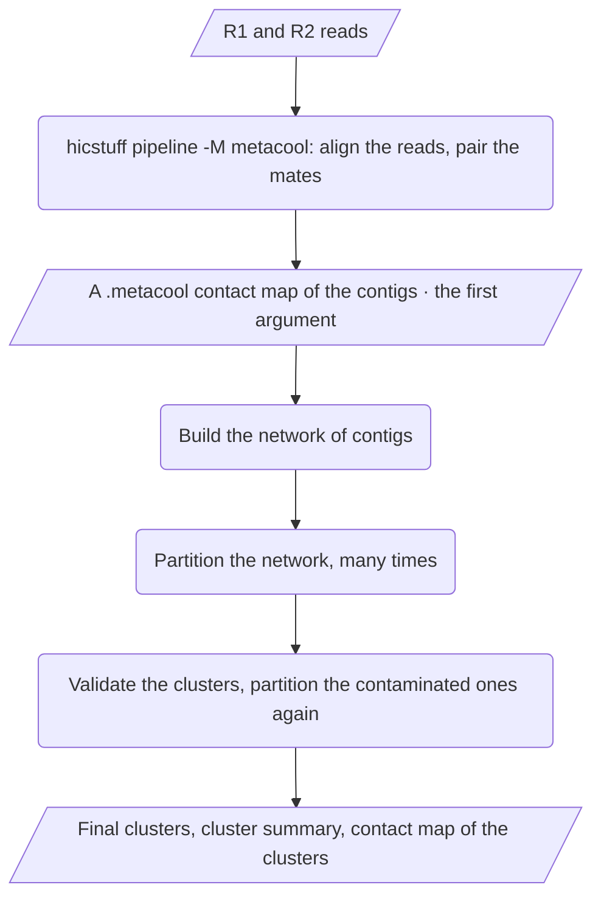

# Concepts

This page explains how metaTOR clusters contigs, and the words the rest of the
documentation uses for it: hits, the network, core and overlapping clusters,
validation and recursive clusters. For the layout of each file, see
[File formats](formats.md).

## The signal

A metaHiC (or meta3C) library is made by cross-linking the cells of a
microbial community, cutting their DNA with a restriction enzyme, ligating
the ends that lie close in space, and sequencing the junctions in pairs. Most
ligations join two pieces of DNA of the same cell: aligned on the assembly,
the two mates of a read pair fall on contigs of the same genome far more often
than on contigs of different genomes. Grouping the contigs that are often
joined finds the genomes.

## The pipeline

`metator pipeline` runs these steps (rounded) in order, from the contact map
of the contigs, its first argument, and writes the files (slanted) between
them. hicstuff makes the map from the reads, and metacooler from pairs files,
as `metator pipeline` does itself from the pairs files or the BAM files of the
run, in a step before these (see [The inputs of a run](cli.md#inputs)):

The three steps are also three commands, `metator network`,
`metator partition` and `metator validation`, run one after the other; see
[Running the pipeline](guides/pipeline.md#running-the-steps-one-by-one).

## Contig data and hits

metaTOR first measures every contig of the map: its size, its GC content,
its number of restriction fragments (with `--enzyme`), its shotgun coverage
(with `--depth`), and its number of **hits**, the ends of the contacts of the
map that lie on it (a contact within the contig counts twice). These, the
**contig data**, go to the contigs table of the map, which the next steps
read and extend with the clusters of the contig.

## The network

Each read pair with its two mates on two different contigs is a contact
between them. The contigs are the nodes of the network, and its edges hold
the contacts between two contigs, **normalised** so that a large or abundant
contig does not attract every other one. The default normalisation,
`empirical_hit`, divides the contacts between two contigs by the geometric
mean of their hits. The map holds the network: its contacts, and the weights
of the normalisation of its contigs. [Building the network](guides/network.md)
lists the other normalisations.

## Partition: core and overlapping clusters

The network is partitioned into communities, groups of contigs more
connected with each other than with the rest, with the
[Louvain](https://en.wikipedia.org/wiki/Louvain_method) algorithm (or
[Leiden](https://en.wikipedia.org/wiki/Leiden_algorithm), with
`--algorithm leiden`). Both are randomised: two runs do not give the same
communities. metaTOR runs the algorithm many times (`--iterations`, 100 by
default) and combines the runs:

- **Core clusters** are the contigs that fall in the same community at every
  iteration.
- **Overlapping clusters** merge the core clusters that fall together at most
  iterations: in at least `--overlap` percent of them (80% by default).

`metator partition` stores every core and overlapping cluster in the map, as
its clustering rounds `core` and `overlapping`. The overlapping clusters of at
least `--size` base pairs (500 kb by default) are the clusters to validate:
the validation writes them as FASTA files, in its temporary directory, for
miComplete.

## Validation and recursive clusters

Each cluster is checked with [miComplete](https://pypi.org/project/micomplete/),
which counts single-copy marker genes, found by Prodigal and HMMER (through
pyrodigal and pyhmmer): their share gives the **completeness** of the
cluster, and their copies its **redundancy**. A cluster with a weighted
completeness of at least 33% whose
contamination, (redundancy − 1) / completeness, reaches 5% is partitioned
again, on the network of its own contigs, with `--rec-iter` iterations (10)
and an overlap of `--rec-overlap` percent (90). Its parts, the **recursive
clusters**, replace it when the most complete of them keeps enough of its
completeness; the step repeats until no cluster is replaced, for 9 steps at
most.

The **final clusters** are the clusters left: the overlapping clusters that
were not split, and the recursive clusters of those that were. A final cluster
is named after both: `metator_00012_00003` is recursive cluster 3 of
overlapping cluster 12, and `metator_00001_00000` an overlapping cluster that
was not split. The contigs in no final cluster are marked `ND`, not determined.

## Cluster quality

At the end of the validation, the log counts the final clusters in five classes,
from their weighted completeness and their contamination, the weighted
redundancy − 1, and the plot `plot/bins_size_distribution.png` shows them:

| Class | Completeness | Contamination |
|---|---|---|
| HQ (high-quality) MAGs | ≥ 90% | ≤ 5% |
| MQ (medium-quality) MAGs | ≥ 70% | ≤ 10% |
| LQ (low-quality) MAGs | ≥ 50% | ≤ 10% |
| Contaminated potential MAGs | ≥ 50% | > 10% |
| Other clusters | < 50% | |

The recursive partition measures the contamination of a cluster otherwise,
relative to its completeness: (weighted redundancy − 1) / weighted
completeness.

## The contact map of the clusters

At the end of a run, metaTOR writes the contacts of all the contigs, grouped
by cluster, as a `.metacool` file: the contact map format of
[metacooler](https://github.com/js2264/metacooler), a
[cooler](https://github.com/open2c/cooler) whose contigs are grouped into
genomes, one per final cluster, in its output directory, from the map it
started from (which it leaves as it was, but with `--inplace`): a map of the
contigs, made before any clustering by
[hicstuff](https://koszullab.github.io/hicstuff/) from the reads, or by
metacooler from pairs files (or by the run itself, from pairs or BAM files).
See
[The contact map of the clusters](guides/metacool.md).
