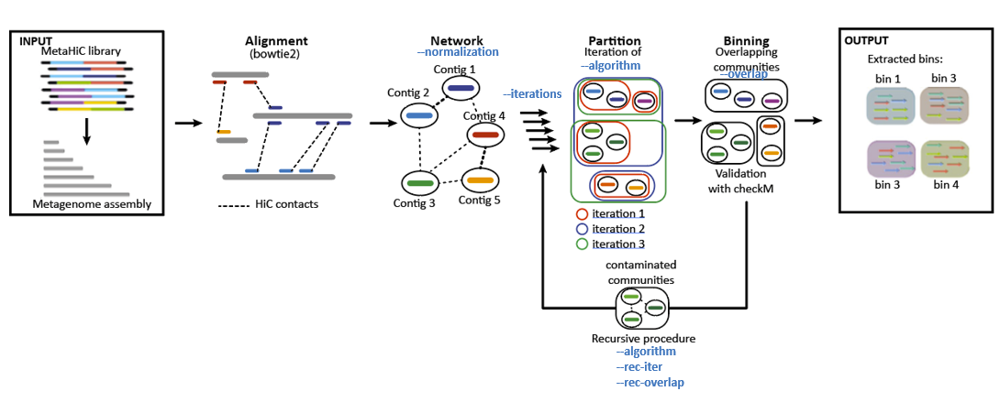
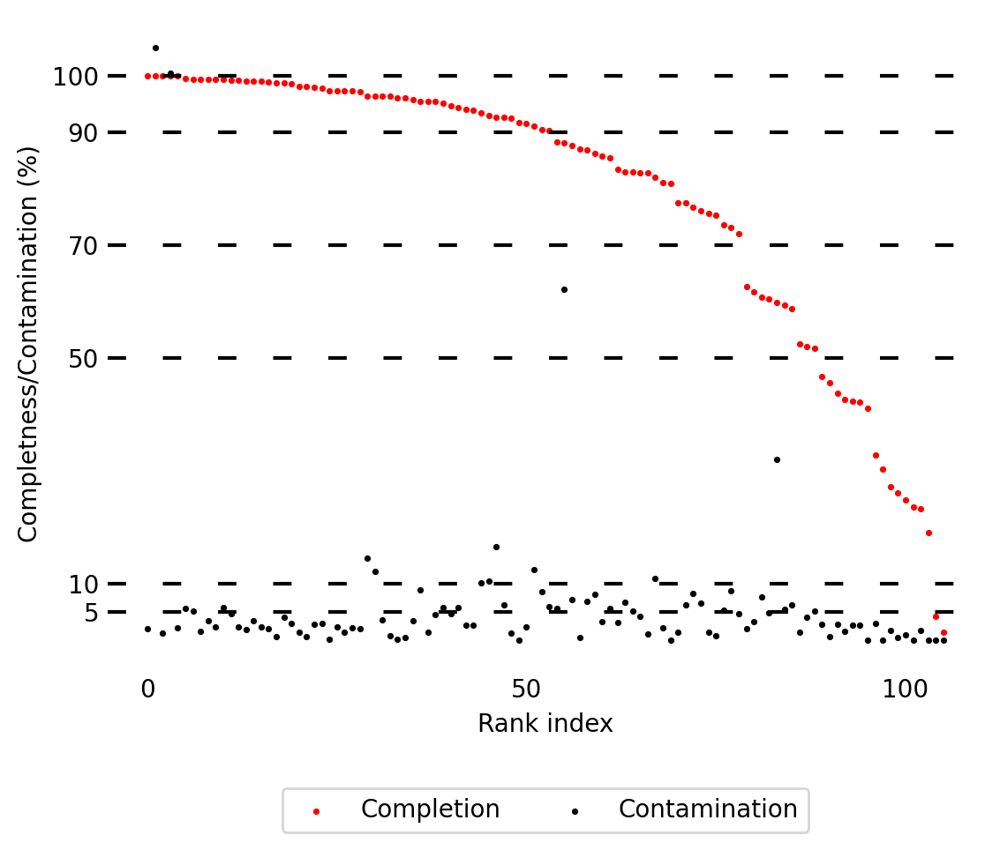
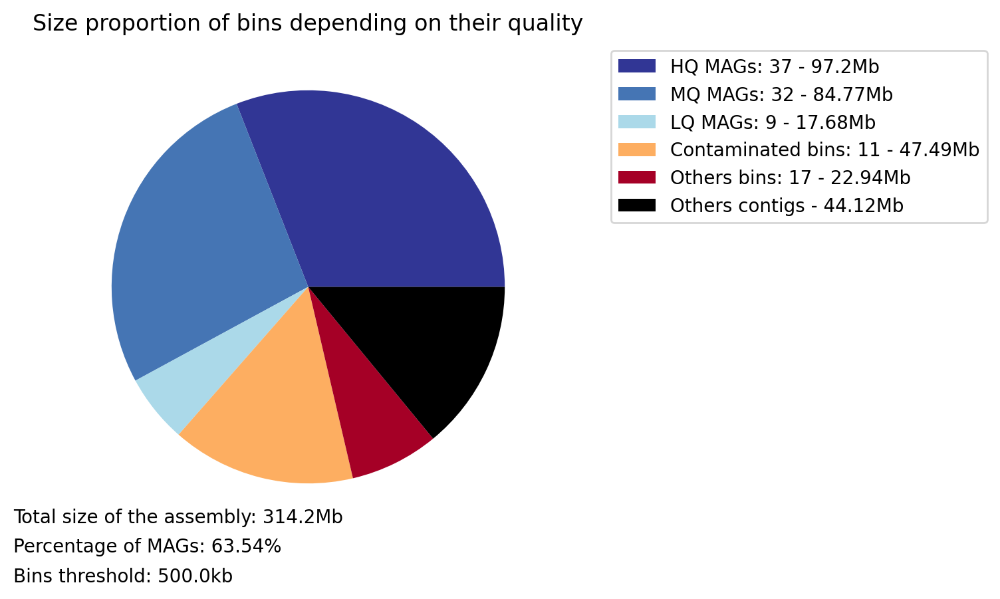

# Partition and validation

The second and third steps of metaTOR turn the network into clusters:
`metator partition` finds groups of contigs in the network, and
`metator validation` checks them with miComplete and splits the contaminated
ones. `metator pipeline` runs both. [Concepts](../concepts.md) explains the
principle; this page covers the parameters and the outputs.



## Partition

```bash
metator partition -a assembly.fa -c binning/contig_data_network.txt \
    -n binning/network.txt -t 16 -o binning
```

| Option | Default | Effect |
|---|---|---|
| `--algorithm` (`-A`) | `louvain` | The community detection algorithm: `louvain` or `leiden`. Louvain is faster, and gave better clusters in our benchmarks on gut and seawater samples |
| `--iterations` (`-i`) | 100 | How many times the network is partitioned. More iterations split the contigs into more, smaller core clusters; 100 is enough to find every cluster in our benchmarks |
| `--overlap` (`-O`) | 80 | Two core clusters are merged into one overlapping cluster when they fall in the same community in at least this percentage of the iterations. A higher threshold gives less contaminated, but less complete, clusters |
| `--res-param` (`-r`) | 1.0 | The resolution of the modularity that the Leiden algorithm optimises (1 is plain modularity, as in Louvain): the higher, the more, smaller communities |
| `--size` (`-s`) | 500000 | The size, in base pairs, an overlapping cluster must reach to be written |
| `--cluster-matrix` (`-C`) | off | Also write `clustering_matrix_partition.npz`: how often each two contigs fell in the same community |
| `--prefix` (`-p`) | none | Names the clusters `<prefix>_metator_…` |

`partition` writes the overlapping clusters of at least `--size` base pairs to
`overlapping_clusters/`, one FASTA file each, and the contig data table with the
core and overlapping cluster of each contig to `contig_data_partition.txt`. When
no cluster reaches `--size`, there is nothing to validate: the pipeline stops
there with an error.

## Validation

```bash
metator validation -a assembly.fa -c binning/contig_data_partition.txt \
    -n binning/network.txt -f binning/overlapping_clusters -t 16 -o binning
```

Validation runs [miComplete](https://pypi.org/project/micomplete/) on every
cluster: Prodigal predicts its genes, and HMMER finds among them the
single-copy marker genes of bacteria (105 markers) and of archaea
(131 markers), through pyrodigal and pyhmmer, their Python bindings. Each
cluster keeps the set that gives it the higher weighted completeness.

A cluster is **contaminated** when its weighted completeness reaches 33% and its
contamination, (weighted redundancy − 1) / weighted completeness, reaches 5%.
Each contaminated cluster is partitioned again, on the network of its own
contigs:

| Option | Default | Effect |
|---|---|---|
| `--iterations` (`-i`) of `validation`, `--rec-iter` (`-j`) of `pipeline` | 10 | How many times each contaminated cluster is partitioned |
| `--overlap` (`-O`) of `validation`, `--rec-overlap` (`-P`) of `pipeline` | 90 | The overlap threshold of the recursive partition |
| `--algorithm`, `--res-param`, `--size`, `--prefix` | | As in the partition |
| `--cluster-matrix` (`-C`) | off | Also write `clustering_matrix_recursive.npz`: how often each two contigs of a cluster partitioned again fell together, in its latest partition (and, in `pipeline`, `clustering_matrix.npz`, the mean of both matrices) |

The parts of a cluster, its **recursive clusters**, are checked with
miComplete in turn. They replace the cluster when the most complete of them
keeps enough of its completeness: more than 0.4 + (c − 0.4) / 1.6, for a
cluster of completeness c. Otherwise the cluster is kept whole. The step
repeats on the recursive clusters that are still contaminated, until none is
replaced, for 9 steps at most.

A part is a recursive cluster only when it is larger than `--size`: when a
cluster is replaced by its recursive clusters, the contigs of its smaller
parts are left out of the final clusters (`ND`).

## Outputs

| File | What it holds |
|---|---|
| `final_clusters/` | One FASTA file per final cluster |
| `recursive_clusters/` | One FASTA file per recursive cluster, in `step_<n>/` for step `n` |
| `cluster_summary.txt` | One row per final cluster, with miComplete's measures and the cluster's abundance |
| `contig_data_final.txt` | The contig data table, with the recursive and final cluster of each contig |
| `binning.txt` | The contigs of the final clusters and their cluster, without header |
| `overlapping_micomplete_results.txt` | miComplete's results on the overlapping clusters |
| `recursive_micomplete_step_<n>.txt` | miComplete's results on the recursive clusters of step `n` |
| `plot/` | The plots of the clusters (below) |

A final cluster is named after its overlapping cluster and its recursive
cluster: `metator_00012_00003` is recursive cluster 3 of overlapping
cluster 12, and `metator_00001_00000` an overlapping cluster kept whole.
`cluster_summary.txt` and `contig_data_final.txt` are described in
[File formats](../formats.md).

### Plots

| Plot | Shows |
|---|---|
| `bins_distribution.png` | The completeness and contamination of the clusters |
| `bins_size_distribution.png` | The share of the assembly in each quality class, and in no cluster |
| `MAGs_GC_distribution.png`, `MAGs_HiC_cov_distribution.png` | The GC content and Hi-C coverage of the contigs of each MAG |
| `MAGs_SG_cov_distribution.png` | The shotgun coverage of the contigs of each MAG, with `--depth` |
| `network_heatmap.png` | The contacts between the final clusters, from the contact map of the run |

|Completeness and contamination|Quality classes|
|:-:|:-:|
|||

The heatmap shows the contacts within each final cluster (on the diagonal)
and between them, at 50 kb resolution, the clusters in the order of
`cluster_summary.txt`: a good clustering has a bright diagonal of blocks on a
dark background. `pipeline` draws it from the contact map of the run, whatever
it started from: the map that it starts from, or the map of the contigs
that it builds from its pairs files.

- **From the map:** the final clusters are laid end to end and cut into
  windows of 50 kb. The contacts of a bin of the map, with another bin or
  within itself, are spread over the windows that it covers, in proportion
  to its length in each, as a map holds no read positions. Only the
  contacts within a window are left out, as from the pairs. With one bin
  per contig, as in the map of the contigs of a run, the contacts within a
  contig are spread evenly over its windows, where its reads would put
  most of them close to the diagonal.
- **Step by step,** `metator validation MAP` draws it from the map, as
  `pipeline` does. Without a map, `metator validation` draws it from the
  `.pairs.gz` files of the output directory, each contact at the
  positions of its reads, and skips it, with a warning, when there are
  none.
- **The image** is saved at about one pixel per window, from 100 to 2000
  dpi, with lines at least a pixel wide between the clusters. It was
  saved at 2000 dpi whatever its size: 5.8 GB of memory to draw the 3,263
  windows of a real metagenome, where it now takes 1.8 GB.
- **A heatmap that cannot be drawn** is a warning: the run goes on.


The heatmap of a run on a real metagenome (MK01: 117,461 contigs, two
libraries), drawn from its map, shown here at 1,200 pixels wide: the run
writes it at about one pixel per window, 4,072 pixels wide.

## What comes next

- [Curating MAGs with anvi'o](curation.md): remove what contamination is left,
  by hand.
- [Viewing and scaffolding MAGs](visualisation.md): the contact map of a
  cluster, and its scaffold.
- [Clustering mobile genetic elements](mge.md): the plasmids and phages, and
  their hosts.
