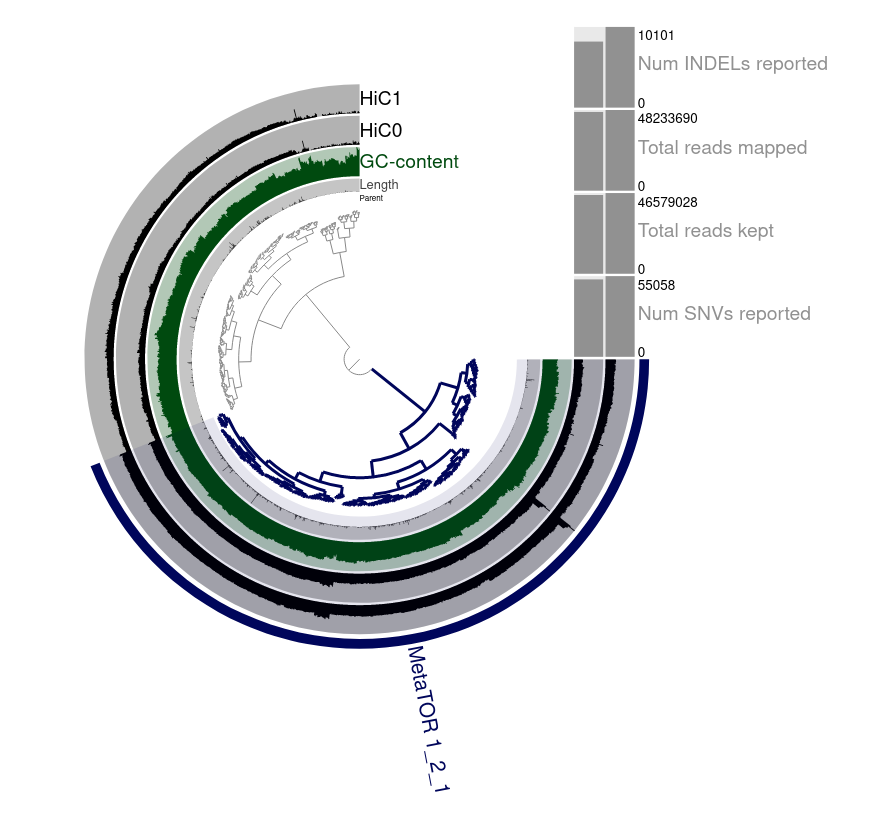
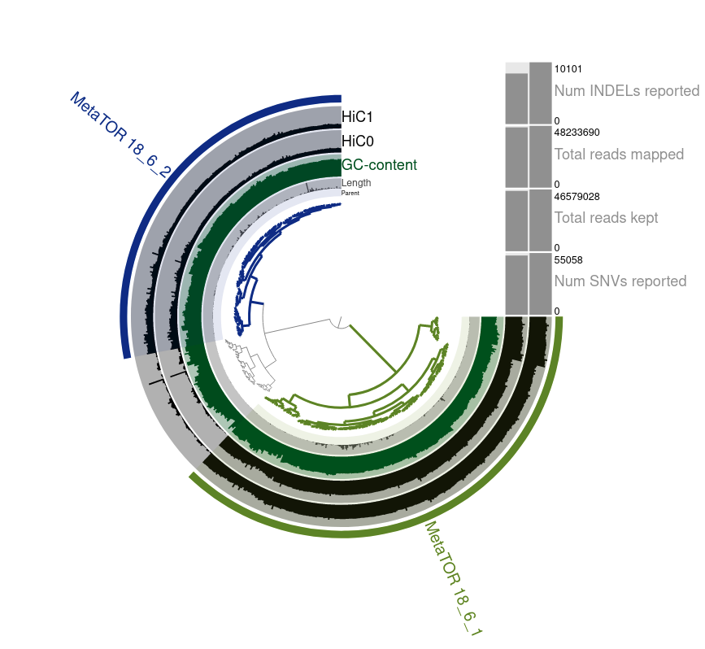
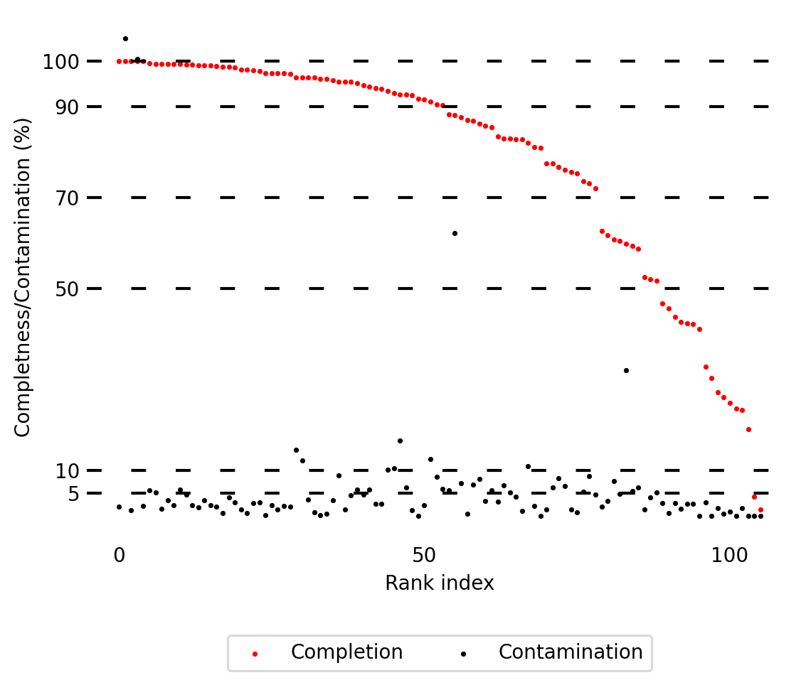
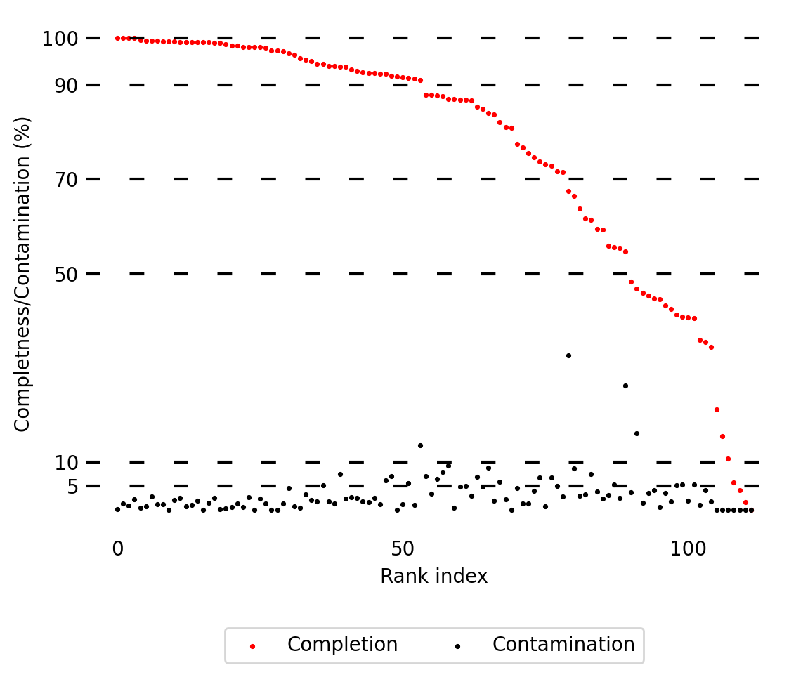
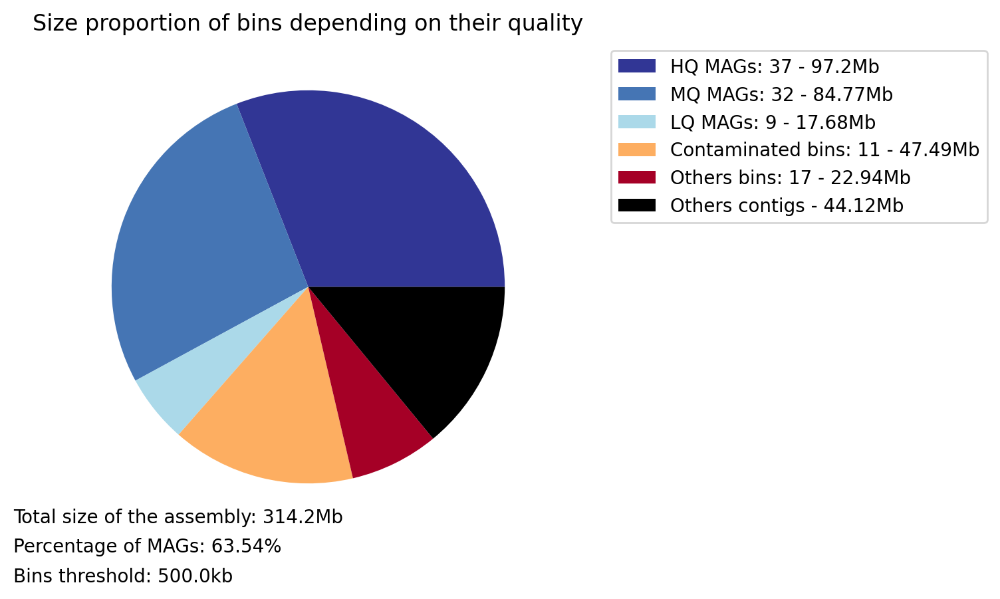
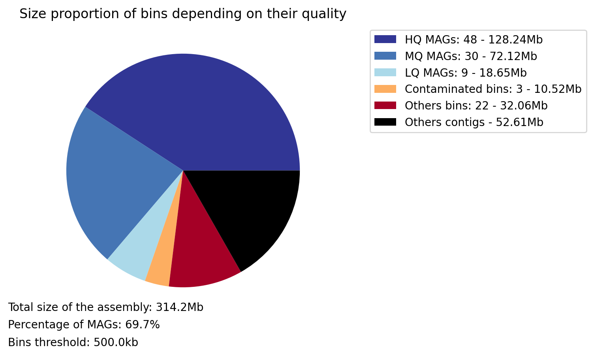

# Curating MAGs with anvi'o

The bins of metaTOR can keep some contamination, the more so as the assembly
keeps small contigs: they make the bins more complete, and noisier.
[anvi'o](https://anvio.org) can remove that contamination by hand, from the
coverage of the contigs across libraries and their sequence composition. This
page goes from the outputs of metaTOR to anvi'o and back; anvi'o's own
[tutorial on refining bins](https://merenlab.org/2015/05/11/anvi-refine/)
explains the refinement itself.

The commands below were written for anvi'o 7. They run on the output
directory `binning` of a run with `--aligner bwa` and two libraries.

## 1. The contigs database

The database holds only the contigs of the final bins, those of
`binning.txt`, extracted with [pyfastx](https://github.com/lmdu/pyfastx),
which is installed with metaTOR:

```bash
mkdir -p anvio
cut -f 1 binning/binning.txt > anvio/contigs.txt
pyfastx extract -l anvio/contigs.txt -o anvio/contigs.fa assembly.fa
```

anvi'o reads only contig names made of ASCII letters, digits and underscores:
rename the contigs of the assembly before the run if needed (see anvi'o's
[note on FASTA files](https://merenlab.org/2016/06/22/anvio-tutorial-v2/#take-a-look-at-your-fasta-file)).
Build the database without splitting the contigs (`-L 0`), and find the
single-copy genes, which give the completeness and redundancy of the bins:

```bash
anvi-gen-contigs-database -f anvio/contigs.fa -o anvio/contigs.db -n metator -L 0 -T 16
anvi-run-hmms -c anvio/contigs.db -T 16
```

More annotations help to curate, and are optional:

```bash
anvi-setup-scg-taxonomy                    # once
anvi-run-scg-taxonomy -c anvio/contigs.db -T 16
anvi-setup-ncbi-cogs                       # once
anvi-run-ncbi-cogs -c anvio/contigs.db -T 16 --sensitive
anvi-display-contigs-stats anvio/contigs.db
```

## 2. The coverage profiles

anvi'o compares the coverage of the contigs across samples: give it each
library on its own (shotgun libraries can be added the same way). Its profiles
are made from BAM files sorted by position and indexed, which `anvi-init-bam`
writes from metaTOR's, sorted by read name:

```bash
for i in 0 1; do
    anvi-init-bam binning/alignment_${i}.bam -o anvio/alignment_${i}.bam
    anvi-profile -i anvio/alignment_${i}.bam -c anvio/contigs.db -o anvio/HiC${i} -S HiC${i} \
        -M 500 -T 16 --skip-hierarchical-clustering --skip-SNV-profiling \
        --contigs-of-interest anvio/contigs.txt
done
anvi-merge -c anvio/contigs.db -o anvio/merged -S HiC -W anvio/HiC*/PROFILE.db
```

With `--aligner bowtie2`, each mate has its BAM file: profile
`alignment_<i>_for.bam`, as the reverse mates tell the same.

- `--skip-hierarchical-clustering` leaves the clustering to each bin, when it
  is refined.
- `--skip-SNV-profiling` saves much time, without the single-nucleotide
  variants.
- `-M 500` keeps the contigs of 500 bp or more, as in the assembly.

## 3. The bins of metaTOR

`binning.txt` is an anvi'o collection, a contig and its bin per line:

```bash
anvi-import-collection binning/binning.txt -c anvio/contigs.db -p anvio/merged/PROFILE.db \
    -C metator --contigs-mode
```

## 4. Refining the bins

`anvi-refine` opens a bin in anvi'o's interactive interface, in a web
browser:

```bash
anvi-refine -c anvio/contigs.db -p anvio/merged/PROFILE.db -C metator -b metator_00001_00000
```

Two bins of a human gut sample: the first cleaned of its contamination, the
second split into two bins.

|A bin cleaned|A bin split in two|
|:-:|:-:|
|||

| Bin | Before: completeness – contamination (%) | After |
|:-:|:-:|:-:|
| Cleaned | 97.2 – 19.7 | 95.8 – 9.9 |
| Split | 95.8 – 98.6 | 94.4 – 0.0, and 93.0 – 0.0 |

## 5. The curated bins

Export the collection, as a contig (split) and its bin per line:

```bash
anvi-export-collection -p anvio/merged/PROFILE.db -C metator -O anvio/curated
```

From `anvio/curated.txt`, metaTOR's Python API writes one FASTA file per bin,
checks the bins with miComplete as `metator validation` does, and draws the
plots of their quality:

```python
import os

import metator.figures as mtf
import metator.io as mio
import metator.validation as mtv
import pandas as pd
import pyfastx

# The collection exported by anvi'o: each contig and its bin.
binning = pd.Series(mio.import_anvio_binning("anvio/curated.txt"))

# One FASTA file per curated bin.
assembly = pyfastx.Fasta("assembly.fa")
os.makedirs("anvio/fasta", exist_ok=True)
for bin_name, contigs in binning.groupby(binning):
    mio.write_contigs(assembly, contigs.index, f"anvio/fasta/{bin_name}.fa")

# miComplete on every bin, with the bacterial and the archaeal markers.
mtv.micomplete_quality("anvio/fasta", "anvio/micomplete.txt", threads=16)

# The plots of metaTOR's validation, for the curated bins.
summary = pd.read_csv("anvio/micomplete.txt", sep="\t", comment="#", index_col=0)
summary = summary.reset_index()
mtf.figures_bins_distribution(summary, "anvio/bins_distribution.png")
mtf.figures_bins_size_distribution(summary, assembly.size, 500000, "anvio/bins_size_distribution.png")
```

On the gut sample, before and after the curation:

| |metaTOR|metaTOR, then anvi'o|
|:-:|:-:|:-:|
|**Completeness and contamination**|||
|**Quality classes**|||

To draw the contact map of a curated bin, from the pairs files of the run
(kept with `--no-clean-up`), add the curated bins to the contig data table as
a column, and give its header to `metator contactmap --object` (see
[Viewing and scaffolding MAGs](visualisation.md)):

```python
binning = mio.import_anvio_binning("anvio/curated.txt")
contigs = pd.read_csv("binning/contig_data_final.txt", sep="\t", index_col=0)
contigs["Anvio"] = contigs["Name"].map(binning).fillna("ND")
contigs.to_csv("binning/contig_data_anvio.txt", sep="\t")
```

```bash
metator contactmap -a assembly.fa -c binning/contig_data_anvio.txt -e DpnII -O Anvio \
    -n metator_00001_00000 binning/alignment_0_sorted.pairs.gz binning/alignment_1_sorted.pairs.gz
```
