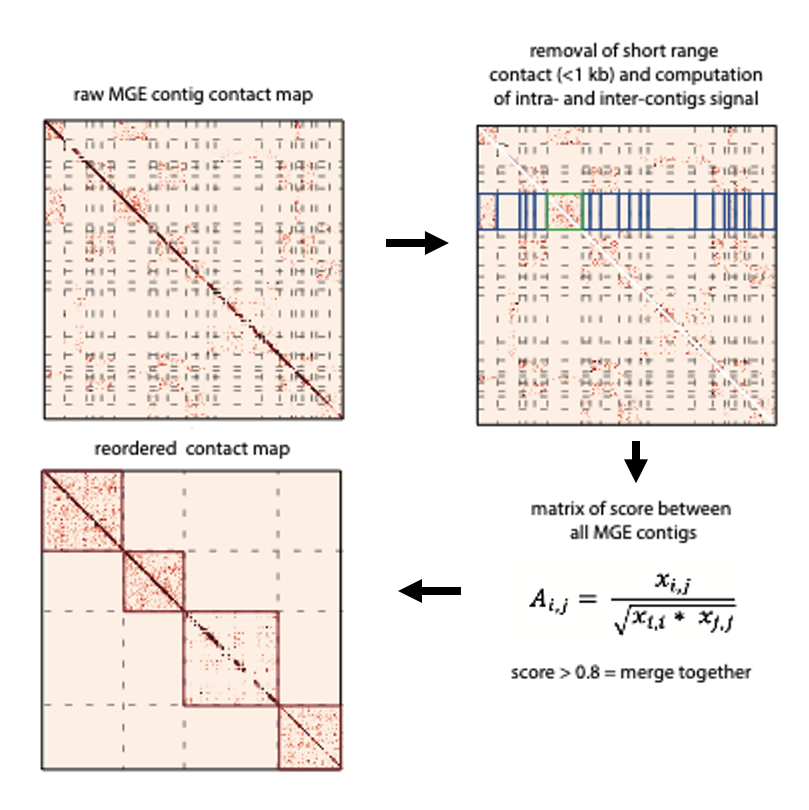

# Clustering mobile genetic elements

Plasmids and phages, the mobile genetic elements (MGEs) of a community, are
clustered poorly by the partition: their contigs are small, an MGE may be in
contact with several hosts, and they carry none of the marker genes that
validation counts. `metator mge` clusters them on their own: given the contigs
of the assembly that are MGEs, found beforehand with an annotation tool, it
groups those that belong to the same element from the Hi-C contacts between
them, which the contact map of the run holds, and stores the MGE clusters in
it.



## How it works

1. **The contacts.** The contacts between each two MGE contigs are those of
   the contact map of the run, summed by pair of contigs, whatever its bin
   size. Within a contig, only the pairs whose mates lie more than 1 kb apart
   count: closer ones say nothing about the element. A map does not tell
   them by its pixels, but by its contact statistics: those that metacooler
   counts per contig as it makes the map from the pairs files (its QC block,
   `qc_intra_contig_long`: the pairs of reads 1001 bp apart or more).
2. **The scores.** The score of two contigs *i* and *j* is their contacts
   divided by the geometric mean of the contacts within each:
   *A<sub>i,j</sub>* = *x<sub>i,j</sub>* / √(*x<sub>i,i</sub>* × *x<sub>j,j</sub>*).
3. **The merges.** The two contigs with the highest score are merged, when
   it is above `--threshold-bin` (0.8 by default): the merged cluster takes the
   contacts of both, and its scores with the other contigs are computed again.
   This repeats until no score is above the threshold. Two equal scores are
   merged in the order of the MGE contigs: the longest first, ties by name,
   whatever the order of the map.

Each contig that was never merged is an MGE cluster of its own. The clusters
are numbered in the order they are made: the merged ones first, then the
others, in the order of the MGE contigs. So the MGE clusters, and their
names, are the same on the map of the contigs and on the map of the clusters
written from it, grouped by cluster.

A pair with a read at position 0 of its contig, which a pairs file, 1-based,
should not hold (but some do), counts within its contig as if that read were
on the first base: metacooler moves it there as it makes the map. Its mate
1001 bp away is then counted as 1000 bp away, below the threshold, where
metaTOR 1.x counted it from the pairs files.

## Running it

```bash
# The map of the run, once metator network stored its network in it (by
# network, pipeline or validation, here in binning): updated in place
metator mge binning/sample.metacool -a assembly.fa -m mges.txt -o binning
```

| Input | What it is |
|---|---|
| `MAP` | The contact map of the run, which `metator network` stored the network of its contigs in (the map that `metator network`, `pipeline` or `validation` wrote in its output directory): it gives the contacts of the MGE contigs, and the size, GC content and hits of each, which `metator network` stored in it. Its clusters, if it has any, are not read. It must hold the contact statistics of the reads of its contigs, at 1001 bp: `hicstuff pipeline -M metacool` and `metacooler create pairs` count them as they make the map from the pairs files, with metacooler 0.4.0 or later (`metacooler create pairs --qc-threshold 1001` with an earlier one) |
| `--assembly` (`-a`) | The assembly that the map was made from, as a FASTA file, plain or compressed with gzip |
| `--mges` (`-m`) | The MGE contigs, one name per line. Those that the map lacks (a map made with a contig filter) are left out, with a warning that names them |

| Option | Default | Effect |
|---|---|---|
| `--threshold-bin` (`-s`) | 0.8 | The score above which two contigs, or clusters, are merged. A lower threshold merges more |
| `--random` (`-r`) | off | Shuffle the contigs between the clusters, keeping the number of contigs of each: a random clustering of the same shape, to compare the real one with. Stored as the round `mge_random`, and written to `mges_binned_random.fa` |
| `--outdir` (`-o`) | current directory | Where `mges_binned.fa` and the map of the run go: `MAP` itself, updated in place, when it is there already |
| `--reassign` | off | Make each MGE cluster a genome of the map, its contigs out of the final clusters that held them (see [MGE genomes](#mge-genomes)). Refused with `--random` |
| `--inplace` | off | Store the MGE clusters in `MAP` itself, in place, rather than in the map of the output directory (see [In the contact map of the run](#in-the-contact-map-of-the-run)) |

A map that `mge` cannot cluster the MGE contigs of is refused before anything
is written, with the reason and how to make one: a map without the contact
statistics of its reads, with them measured from its pixels (`metacooler qc
--store`) or at another distance than 1001 bp, or without the columns of
`metator network` (give `mge` the map that `network`, `pipeline` or
`validation` wrote in its output directory); and a map that holds none of the
MGE contigs. So is an
assembly that is not a FASTA file, plain or compressed with gzip, as
`network`, `validation` and `pipeline` refuse it.

## Outputs

| Output | What it holds |
|---|---|
| `mges_binned.fa` | One record per MGE cluster, `MetaTOR_MGE_00001` and on: its contigs, the longest first (ties by name), joined by 200 `N`, in lines of 80 bases |
| The round `mge` of the map | One cluster per MGE cluster, named as its record: its contigs, length, GC content, hits and clustering score (`BinningScore`) (see [In the contact map of the run](#in-the-contact-map-of-the-run)) |
| `metator_mge_<date>.log` | The log of the run, in the current directory |

The clustering score of an MGE cluster is the lowest score at which its
contigs were merged (missing for a single contig). The record of a cluster
holds a single sequence, so that the tools that check the quality of an MGE
genome, which expect one sequence per genome, read each cluster as one.
metacooler writes it (`metacooler.write_fasta`, stitched).

`mge` writes no summary table: the round `mge` holds what
`mges_bin_summary.tsv` held (`mges_cluster_summary.tsv` in a development
build). An earlier run's, in the output directory, would pass for this run's:
it is refused, with or without `-F`, before any work, and never removed.

## In the contact map of the run

`mge` stores the MGE clusters in the contact map, `MAP` (see
[The contact map of the clusters](metacool.md)): they become the round `mge`
of its clustering rounds (see
[Clustering rounds](metacool.md#clustering-rounds)), after the rounds that
it holds, those of a clustering run (`core`, `overlapping`,
`recursive_<k>`, `final`), which are kept: their clusters, contigs and
values. Each MGE
cluster is named as its record of `mges_binned.fa` (`MetaTOR_MGE_00001`),
with its contigs and its columns: its length and number of contigs, which
metacooler computes from its contigs, and its GC content (`GC`), hits
(`Hit`) and clustering score (`BinningScore`). The entry `mge` of the
`metator` key of the metadata of the map records the run: the version of
metaTOR, its command line and parameters, and what it read of the map, under
`read` (the `GC_content`, `Hit` and `qc_intra_contig_long` columns of its
contigs table, and the `qc` key of its metadata). The clusters of every round
are one table, where a column that a round
lacks is missing in its rows: so a column of whole numbers, or of booleans,
of the rounds of the clustering run, which the round `mge` lacks, is stored
as decimals, or as text (`True`, `False`), from then on. The genomes and
contigs tables of the map, the final MAGs if it has any, are left as they
were, but with `--reassign` (see [MGE genomes](#mge-genomes)), and so is the
rest of the map: its contacts, contact statistics and metadata.

```python
import metacooler

mc = metacooler.MetaCooler("hicstuff/sample.metacool")
mc.clusters[mc.clusters["round"] == "mge"]  # one row per MGE cluster
mc.cluster_members("mge")                   # their contigs, in map order
mc.metadata["metator"]["mge"]               # the run
```

`metator dump` writes them out with the other rounds of the map of the
clusters of a run, in `clusters.txt` and `cluster_members.txt` (see
[`dump`](../cli.md#dump)), and the round `mge_random` of a run with
`--random` too.

A second run replaces the round `mge`, and only it; `--random` stores the
round `mge_random`, which replaces only an earlier `mge_random`. The map is
written as `metator partition MAP` writes it (see
[Step by step](metacool.md#step-by-step)): in an edit session of metacooler,
validated in full, then renamed into place, and locked while the run writes
it. It goes to the output directory, under the name of `MAP`, which is left as
it was (from an entry of a `.mmetacool` collection, `NAME.metacool`); it is
`MAP` itself, updated in place, keeping its mode (through a symbolic link, the
file it points to), when `MAP` is the map of the output directory already, or
with `--inplace`. A map of an earlier run in the output directory is
replaced only with `-F`. What `partition MAP` refuses is refused before any
work, with the reason in the log: a map that is not there or that metacooler
cannot open, an entry with `--inplace`, a map of the output directory that is
one of the inputs of the run (even with `-F`) or that exists without `-F`,
and a map that another run holds.

`mge` reads no cluster of the map: it runs as well on the map of the contigs,
once `metator network` stored its network there, as on the map of the
clusters, and gives the same MGE clusters on both. But a run that replaces
the clusters of the map drops the rounds `mge` and `mge_random`, and their
entries, with a warning that says so, as it drops every round that it does
not make: `partition MAP`, `validation MAP` and `pipeline MAP`. Run `mge`
again on the map that they write to store the MGE clusters there.

## MGE genomes

With `--reassign`, each MGE cluster of the run is a genome of the map too,
named after it (`MetaTOR_MGE_00001`), with its values in the genomes table:
its GC content, hits and clustering score (`GC`, `Hit`, `BinningScore`). Its
contigs leave the genomes that held them: final clusters (MAGs), or
`__unbinned__`. The other genomes are kept, with their other contigs and the
values of their validation (miComplete's completeness and contamination,
among them), which describe them with the contigs that they lose: the log
names each final cluster that loses contigs, and how many. A final cluster
whose contigs are all MGE contigs is no genome any more, and its values leave
the genomes table with it, with a warning (the round `final` keeps its
contigs and the values of miComplete). The column `mge` of the genomes table
says which genomes are MGE genomes: `True` for them, `False` for the final
clusters, as text, as the column `recursive` of the summary of the clusters.

```bash
metator mge binning/sample.metacool -a assembly.fa -m mges.txt -o binning --reassign
metator dump binning/sample.metacool -o tables
```

`metator dump` follows the genomes of the map (see [`dump`](../cli.md#dump)):
`binning.txt` lists the MAGs and the MGE genomes, each contig in its genome;
the `Final_cluster` of an MGE contig in `contig_data_final.txt` is its MGE
genome; `cluster_summary.txt` writes the final clusters, with the values of
their validation, then the MGE genomes, with theirs, and the column `mge`.
The clustering rounds keep the history: the round `final` holds the final
clusters as the run made them, with their MGE contigs, and the round `mge`
the MGE clusters.

```python
import metacooler

mc = metacooler.MetaCooler("binning/sample.metacool")
mc.genomes[mc.genomes["mge"] == "True"]  # the MGE genomes, with GC, Hit and BinningScore
```

A run that replaces the round `mge` (a run without `--random`) undoes the MGE
genomes of the map first: those that the column `mge` names, and those named
after a cluster of its round `mge`, as `metacooler reassign --round mge`
makes them. Their contigs go back to their final cluster, or to
`__unbinned__`. So a second run with `--reassign` replaces the MGE genomes
with its own, rather than adding them, and a run without `--reassign` leaves
the map with its final clusters alone; a final cluster that had lost all its
contigs comes back without values, with a warning (run `validation` again to
measure them). `--random` leaves the genomes as they are, and is refused with
`--reassign`: a random clustering makes no genome. `validation MAP` and
`pipeline MAP` make their final clusters the genomes of the map, without MGE
genomes. An MGE cluster named after a genome that the run keeps (a genome
renamed by hand) is refused: their contigs would make one genome.

`metacooler reassign` writes the map anew from `MAP`, as for the map of the
clusters of a validation: its contigs are grouped by genome again when they
were (the map of a validation), its contacts and the columns of its contigs
table are kept, and metacooler counts the contacts within and between its
genomes again, in its contact statistics.

## The hosts

`metator host` finds the MAGs that host the MGE clusters: those that their
contigs are in contact with. It reads the map that `metator mge` stored its
MGE clusters in, and stores what it finds there.

```bash
# The map of the clusters of a run, in binning: its MGE clusters, then their
# hosts, updated in place
metator mge binning/sample.metacool -a assembly.fa -m mges.txt -o binning
metator host binning/sample.metacool -o binning
```

1. **The MAGs.** The genomes of the map: the final clusters of
   `validation` or `pipeline`, or the bins of another binner, made the
   genomes of the map by `metacooler reassign` (on a map that `metator
   network` stored the network in). `__unbinned__` is no MAG, and neither is
   a genome named after an MGE cluster: an MGE cluster made a genome of the
   map (see [MGE genomes](#mge-genomes), or `metacooler reassign --round
   mge`).
2. **The MGE contigs.** A contig of an MGE cluster counts for its MGE
   cluster only. A validation clusters the MGE contigs with the other
   contigs, and a final cluster often holds some (a plasmid with its host):
   it is taken without them, or the contacts of an MGE cluster within itself
   would count as contacts with that cluster.
3. **The signal.** The signal of an MGE cluster with a MAG is the sum of the
   weights of the edges of the network between their contigs, with the
   normalization that `metator network` stored (`empirical_hit` by default,
   which corrects for the coverage of the contigs), and the number of
   contigs of the MAG in contact with the MGE cluster is counted too.
4. **The hosts.** A MAG hosts the MGE cluster when its signal is at least
   `--min-share` percent (10 by default) of the signal of the MGE cluster with
   all the MAGs, and the MGE cluster is in contact with at least
   `--min-contigs` of its contigs (5 by default). An MGE cluster can have one
   host, several, or none.

| Option | Default | Effect |
|---|---|---|
| `--min-share` (`-s`) | 10 | The share of the signal of an MGE cluster with the MAGs, in percent, from which a MAG is a host |
| `--min-contigs` (`-c`) | 5 | The number of contigs of a MAG in contact with an MGE cluster from which the MAG is a host |
| `--outdir` (`-o`) | current directory | Where `mge_hosts.txt`, `mge_hosts.png`, the log and the map of the run go: `MAP` itself, updated in place, when it is there already |
| `--inplace` | off | Store the hosts in `MAP` itself, in place, rather than in the map of the output directory |

### Reading the hosts

The share of a host is that of the signal of the MGE cluster with the MAGs:
its contacts with the contigs in no MAG, and with the other MGE clusters,
do not count. An MGE cluster with few contacts with the MAGs, as a phage
that the library caught in its free particles, can then have a host from a
small part of its contacts: on a mock community, a free phage of 42 kb had a
host from 1% of its contacts. `share_of_all`, in `mge_hosts.txt`, is the
share of all its contacts with the other contigs: a host with a small one
calls for a look at the contact map.

Several hosts are not always several species. A genome that the binning
split into several clusters (a contaminated cluster partitioned again, for
example) gives each of them a share of the signal of its MGE clusters: on the
mock community, 12 of the 14 MGE clusters with several hosts had the
clusters of one genome as hosts. Check the taxonomy of the hosts, or their
contacts with each other, before reading several hosts as a broad host
range. Related plasmids, assembled into shared contigs, give hosts of each
genome that carries one.

`metator host` filters on no estimate of the noise of the library, and keeps
no MAG as the only host when it has most of the signal: the rule of
[Bignaud et al. 2025](../citation.md), which adds both, is left to the
analysis of `mge_hosts.txt`.

### What host writes

| Output | What it holds |
|---|---|
| `mge_hosts.txt` | One row per MGE cluster and MAG in contact: their signal, the number of contigs of the MAG in contact, the share of the signal (`share`) and of all the contacts of the MGE cluster (`share_of_all`), and whether the MAG is a host (see [Hosts of the MGE clusters](../formats.md#hosts-of-the-mge-clusters)) |
| `mge_hosts.png` | The distribution of the signal of the hosts, on a log scale, and of their share |
| The round `mge` of the map | The number of hosts of each MGE cluster, their names by decreasing share, and their shares (`n_hosts`, `hosts`, `host_shares`) |
| The genomes table of the map | The number of MGE clusters that each MAG hosts, and their names (`n_mges`, `mges`) |
| `metator_host_<date>.log` | The log of the run, in its output directory |

The entry `host` of the `metator` key of the metadata of the map records the
run: the version of metaTOR, its command line and parameters, the
normalization of the network that it read and its digest
(`network_digest`), and what it read of the map (`read`).

```python
import metacooler

mc = metacooler.MetaCooler("binning/sample.metacool")
mge = mc.clusters[mc.clusters["round"] == "mge"]
mge[["name", "n_hosts", "hosts", "host_shares"]]  # the hosts of each MGE cluster
mc.genomes[["name", "n_mges", "mges"]]              # the MGE clusters of each MAG
mc.metadata["metator"]["host"]                      # the run
```

`metator dump` writes them with the rest of the map: the hosts of each MGE
cluster in `clusters.txt`, and the MGE clusters of each final cluster, last,
in `cluster_summary.txt`.

The hosts describe the round `mge`, the genomes and the network of the map
as `metator host` read them. A second `host` run replaces them (in place,
with a warning before any work), and a run that replaces one of these drops
them, with a warning once its map is written: run `host` again on its map.
So do `mge` (but `mge --random`, which leaves the round `mge` as it was),
`partition`, `validation` and `pipeline`, and `network` when it stores
another network than the one the hosts were found on (another
normalization, or the contacts of another library).

The phages of a community and their hosts are the subject of two of the
studies listed in [Citing metaTOR](../citation.md): Marbouty et al., 2021,
and Bignaud et al., 2025.
