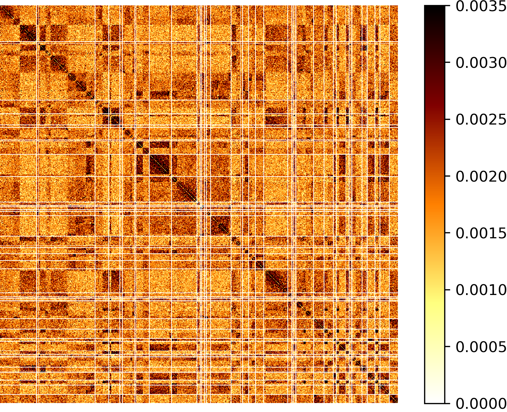
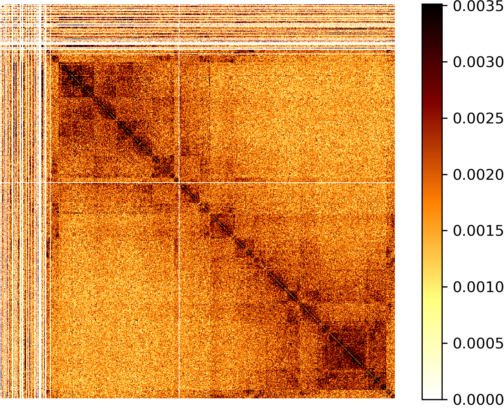
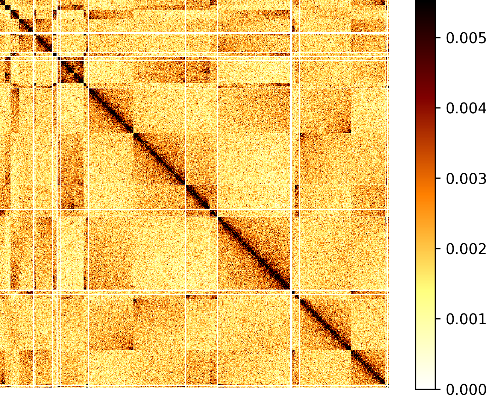
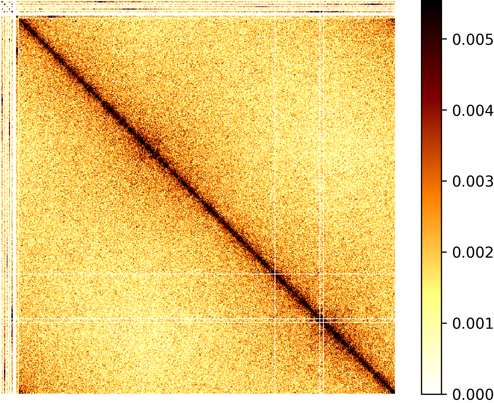
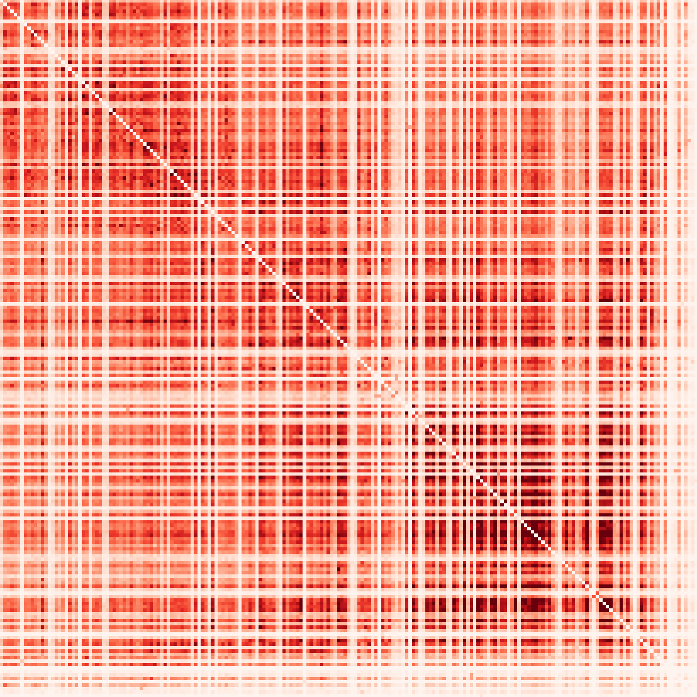
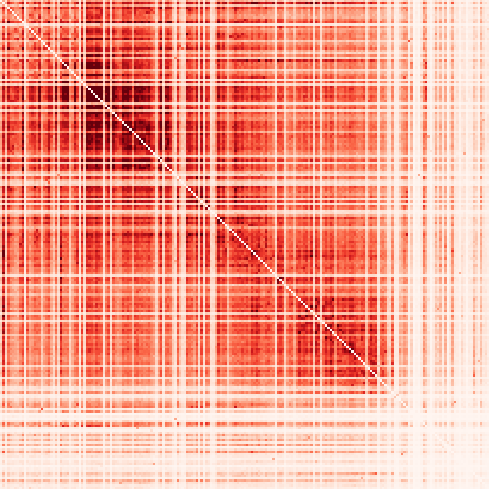
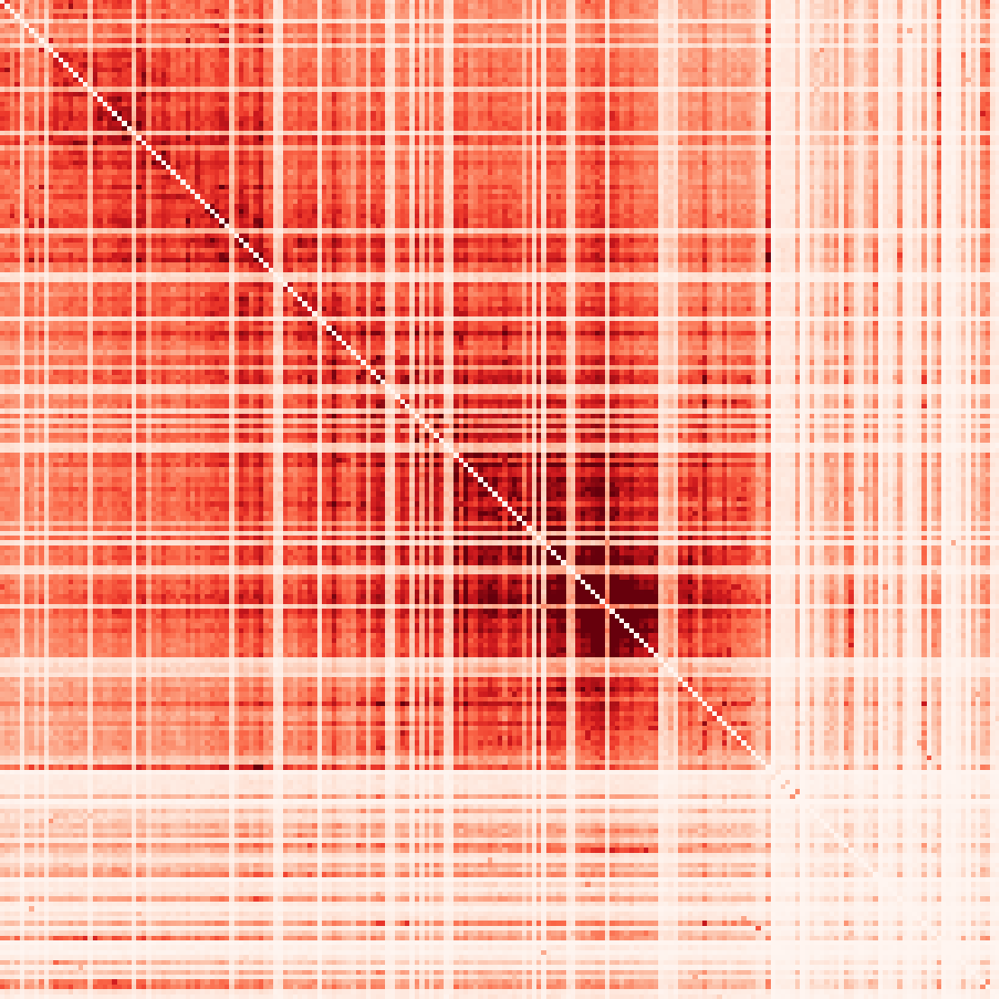

# Viewing and scaffolding MAGs

A MAG can be looked at as a Hi-C map of its own contigs: its contacts show
whether it is one genome, and in which order its contigs follow each other.
`metator contactmap` builds the contact map of a bin, `hicstuff view` draws
it, and `metator scaffold` orders and orients the contigs of a bin from its
contacts.

## The pairs files

These commands read the pairs files of the run, `alignment_<i>_sorted.pairs.gz`,
sorted and indexed with pairix, which `metator network` writes and
`metator pipeline` keeps only with `--no-clean-up`. A pairs
file without its index is sorted, compressed and indexed the first time it is
read, or beforehand with `metator pairs`:

```bash
metator pairs -t 16 sample.pairs
# sample_sorted.pairs.gz and its index, sample_sorted.pairs.gz.px2
```

`--remove` (`-r`) deletes each input once it is indexed. With its index, a
command reads only the contacts of the contigs it needs. `contactmap` can read
the contact map of the run instead (see [From a contact map](#from-a-contact-map)).

## The contact map of a bin

```bash
metator contactmap -a assembly.fa -c binning/contig_data_final.txt -e DpnII \
    -n metator_00007_00000 -s 1000 -o metator_00007_00000 binning/alignment_0_sorted.pairs.gz
```

`contactmap` takes the contigs of the bin from the contig data table, keeps
those of at least `--min-size` (`-s`, 5 kb by default) base pairs, extracts the
pairs between them, and builds their contact map with hicstuff, at the
resolution of the restriction fragments of `--enzyme` (`-e`):

```console
INFO :: Generate HiC contact map for metator_00007_00000
INFO :: 503 pairs have been extracted.
INFO :: ## hicstuff: v3.3.0 log file
...
INFO :: 503 pairs used to build a contact map of 161 bins with 145 nonzero entries.
```

| `--object` (`-O`) | `--name` (`-n`) |
|---|---|
| `final_bin` (default) | The name of a final bin: `metator_00007_00000` |
| `contig` | The name of a contig |
| `core_bin`, `overlapping_bin` | The numeric ID of the bin, as in the contig data table: `12`; or, for an overlapping bin, the name of a bin made from it: `metator_00012_00000` |
| `recursive_bin` | The name of the bin, `metator_00012_00003`: recursive bins are numbered within their overlapping bin |
| The header of a column of the contig data table | A value of that column: to map bins made elsewhere, add them to the table as a column, `Other` for instance |

| Option | Default | Effect |
|---|---|---|
| `--mat-fmt` (`-m`) | `graal` | The format of the map: `graal` (plain-text sparse matrix), `bg2` (2D bedgraph) or `cool` |
| `--filter` (`-f`) | off | Leave out the uncuts and loops (see [Checking a library](qc.md)) |
| `--pcr-dup` (`-D`) | off | Leave out the PCR duplicates |
| `--outdir` (`-o`) | `contact_map_<name>` | Where the outputs go |

The outputs are named after the bin:

| File | What it holds |
|---|---|
| `<name>.fa` | The contigs of the map |
| `<name>.mat.tsv` | The map, in graal format |
| `<name>.bg2`, `<name>.cool` | The map, with `--mat-fmt bg2` or `cool` |
| `<name>.frags.tsv`, `<name>.chr.tsv` | Its restriction fragments and contigs |
| `<name>.valid_idx.pairs.gz` | Its pairs, with the fragment of each mate (`<name>.valid_idx_filtered.pairs.gz` with `--filter`, `<name>.valid_idx_pcrfree.pairs.gz` with `--pcr-dup`) |
| `metator_contactmap_<date>.log`, `<name>.hicstuff_<date>.log` | The logs of metaTOR and hicstuff |

`--mat-fmt cool` runs the `cooler` command, installed with metaTOR: run it in
the environment that metaTOR is installed in.

### From a contact map

`contactmap` also takes the `.metacool` contact map of the run (or an entry
of a `.mmetacool` collection) in place of its pairs files:

```bash
metator contactmap -a assembly.fa -c binning/contig_data_final.txt -e DpnII \
    -n metator_00007_00000 -s 1000 -o metator_00007_00000 binning/metator.metacool
```

It takes the same contigs, and writes the map of these contigs as
`metacooler extract` writes it, `<name>.cool`, at the bins of the map: one
bin per contig in a map of metaTOR, where hicstuff maps the restriction
fragments of the contigs from the pairs files. Its contacts are those of the
pairs the map holds: the map of the restriction fragments of the pairs files
it was made of, summed by pair of contigs. It also writes `<name>.fa`, the
contigs of the map, and its log says what it wrote: the bins and contigs of
the map, its pixels (`NNZ`) and its contacts (`sum`).

A map holds no read positions: `--filter`, `--pcr-dup` and a `--mat-fmt`
other than `cool` (the default, then) are refused, and `--enzyme` is not
used. A map with pairs files or another map, a map that gives one of the
contigs another length than the contig data table, and a map that stores
both triangles of its matrix are refused too, with the reason in the log,
before `<name>.fa` is written and an earlier `<name>.cool` replaced (`-F`).
A contig that the map lacks (a map made with a contig filter) is left out,
with a warning; with none of them, no map is written, and an earlier
`<name>.cool` is removed (`-F`). `cooler show` and `cooler dump`, installed
with metaTOR, read the map, as `hicstuff view` does.

## Drawing the map

[hicstuff](https://koszullab.github.io/hicstuff/), installed with metaTOR,
draws the map, binned at 5 kb and normalised:

```bash
hicstuff view -f metator_00007_00000/metator_00007_00000.frags.tsv -n -b 5kb -c afmhot_r \
    -o metator_00007_00000/map.png metator_00007_00000/metator_00007_00000.mat.tsv
```

A cool map needs no `-f`. The map of a good MAG holds most of its contacts on
the diagonal of each contig, and a few between contigs, which tell their
order:



## Scaffolding a bin

`metator scaffold` orders and orients the contigs of a bin into scaffolds:

```bash
metator scaffold -b metator_00007_00000 -i binning/final_bin_unscaffold/metator_00007_00000.fa \
    binning/alignment_0_sorted.pairs.gz
```

It looks at the two ends of each contig, the `--window-size` (`-w`, 5 kb)
base pairs at each end (the whole contig, for a shorter one). The contacts
between the ends of two contigs are normalised by the contacts that each end
has at the same distance within its own contig (small contigs, which have
none at that distance, get a low default score). Each end is joined to the
end it scores best with, above `--threshold` (`-T`, 0.05); the chains of
contigs are the scaffolds, circular when they close.

| File | What it holds |
|---|---|
| `<bin>_scaffolded.fa` (`--out-fasta`, `-o`) | One record per scaffold, `metator_scaffold_0001` and on, its contigs joined by `--junctions` (`-j`, `NNNNN`) |
| `<bin>_info_frags.txt` (`--out-frags`, `-O`) | For each scaffold, its contigs in order, with their length and orientation (`1` or `-1`) |

```console
>metator_scaffold_0001 linear length: 12167
NODE_2487	0	11273	1
NODE_202465	0	894	1
>metator_scaffold_0002 circular length: 2446
NODE_47874	0	1777	-1
NODE_442506	0	669	1
```

The length of a scaffold is that of its contigs, without the junctions.
`metator pipeline --scaffold` scaffolds every final bin this way, into
`scaffold_bin/`, with the junctions of its `--junctions` (`-J`).

## Scaffolding with instaGRAAL

[instaGRAAL](https://github.com/koszullab/instaGRAAL) scaffolds a genome from
its Hi-C contacts with a model of the Hi-C signal, and needs an NVIDIA GPU. It
reads the FASTA file and the pairs that `metator contactmap` writes, best with
the contigs of at least 5 kb (the default `--min-size`), which it scaffolds
far better than shorter ones:

```bash
instagraal-endtoend metator_00007_00000/metator_00007_00000.fa \
    metator_00007_00000/metator_00007_00000.valid_idx.pairs.gz --enzyme DpnII \
    -o metator_00007_00000/instagraal
```

Two MAGs of a human gut sample, before and after instaGRAAL:

|Before|After|
|:-:|:-:|
|||
|||

The second MAG is scaffolded into one circular chromosome, but for a few
small contigs, which instaGRAAL places poorly. The first shows an error
instaGRAAL often makes on bacterial chromosomes: their secondary diagonal,
the contacts between the two arms of the chromosome, disturbs its model, and
it misplaces pieces along the diagonal, in steps. Both can be put right by
hand, from the contact map.

The convergence of instaGRAAL, after 1, 10 and 50 iterations:

|1|10|50|
|:-:|:-:|:-:|
||||
